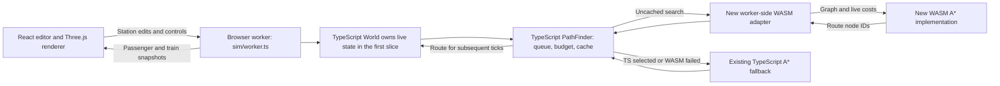

# Metro WASM routing experiment

The reported benchmark outcome was no FPS improvement. Keep the prototype for
local comparison. Normal startup, web builds, and deployment use TypeScript.
Only the explicit Vite mode `wasm-experiment` includes the kernel. Its build
goes to `game/dist-wasm` while Cloudflare serves `game/dist`.

Use `npm --prefix game run dev:wasm` for dev or
`npm --prefix game run build:game:wasm` followed by
`npm --prefix game run preview:wasm`. On localhost `/benchmark`, run both
backends with the same settings. A usable WASM result requires a positive
search count and no fallback. Compare tick progression alongside frame timing.
Use the repo performance reference for measurements.

Only uncached A* moved. TypeScript owns the world, graph construction, live
costs, queue, budget, and cache. The kernel uses the host's `Math.hypot` to
preserve tie behavior. A failed search retries in TypeScript in the same worker.
Run `npm --prefix game run test:wasm` for seeded parity and
`node tools/check-wasm-routing.mjs` against the experimental preview for
worker and fallback checks.

To verify release isolation, leave generated bindings in place, run the normal
game build, and inspect `game/dist` for routing WASM binaries and loader chunks.
The normal benchmark should hide the backend picker even on localhost.

## Code boundaries

| Keep | Build or adapt |
| --- | --- |
| React, Zustand, Three.js, input, audio, station editor, JSON saves | Local WASM compilation, generated bindings, and a Vite worker loader |
| [`SimSlice.ts`](game/src/app/store/slices/SimSlice.ts), [`worker.ts`](game/src/sim/worker.ts), and the app-facing messages in [`protocol.ts`](game/src/sim/protocol.ts) | Local backend selection and a diagnostic confirming which backend ran |
| TypeScript graph construction, path request queue, search budget, and cache in the first slice | The A* search from [`station.ts`](game/src/sim/station.ts), with a typed interface for graph data, live costs, and route results |
| [`World.ts`](game/src/sim/world/World.ts) as the authority for live state in the first slice | Additional simulation systems in later slices, with explicit ownership as each moves |

Keep the builder and renderer's shared rules available to their TypeScript callers. Preserve `metro-save` v1, the six-float passenger stride, and route-preview tokens.