# Station Designer

**A 3D sandbox about moving crowds through a metro station you build yourself.**

Block-based construction (1 block = 1 m) with hard-edged voxel art, real rolling stock, real
passenger flow. No money, no staff hiring, no upkeep: you build, the crowds arrive, and the
station either copes or it does not.

| | |
|---|---|
| **Platform** | React 19 + Vite + TypeScript, plain three.js, Web Worker simulation, Cloudflare Workers static hosting |
| **Mode** | Sandbox / puzzle-sim. Single player. |
| **View** | Free 360° orbit with an isometric build preset, cutaway, storey slicing, flat orthographic elevations |
| **Status** | As-built specification, draft 11 (2026-10-22). Describes the build shipped at `stationdesigner.com/game/`; anything not in the build is marked **Planned** |
| **One-liner** | Overcrowd's readable doll-house dioramas, Mini Metro's flow pressure, real Chinese metro rolling stock |

Draft 11 is the as-built pass. It replaces the original named levels, settings page, dynamic
snapshot save, queue lanes, air-quality model, line tool, platform entity and per-exit out-rate
with the shipped versions, and marks every unbuilt system **Planned**.

---

## 1. Concept art

All sheets are vector, generated from [`tools/gen-art.mjs`](tools/gen-art.mjs) (`node tools/gen-art.mjs`).
They are drawn in a **true isometric** projection (equal foreshortening on all three axes,
1 block = 1 m), so they double as an art-direction target rather than loose mood boards and a
rendered piece stands in a drawing undistorted. Each sheet is drawn in **Simplified Chinese**
with an `*-en.svg` English sidecar; only identifiers and units stay in Latin script (§9.2).
Sheet 12 is animated (SMIL, self-contained).

### 1.1 The station you are building — isometric cutaway


An underground concourse in doll-house view with the roof cut off, and the platform storey
visible through the escalator void. Nine readable zones: fare gates, ticket machines, retail,
platform, circulation, surface entrance, advertising, floor guidance and lift. Everything here is
a placeable module from the catalogue, and every person is a simulated agent with a destination.

### 1.2 Depth is not decoration — vertical section


One station, four storeys: an over-ground viaduct (Line 1, catenary), the surface plaza with the
entrance pavilion, a concourse, and two stacked platform storeys behind screen doors. Every
storey change is a walk, a queue and a capacity limit. This is the drawing that drives the whole
simulation design.

### 1.3 The block system



One block = one cell with six faces. Faces carry finishes (floor, ceiling, walls per side), and
the 8-neighbour exposure mask decides which of them are drawn: a side a solid neighbour shares
draws nothing, so a run of blocks is one flat surface. A block is a hard cube by default; the
方块 tool's 半墙 and 三角 cut modes lay a half-thickness or wedge course in the same grid (§4.2).

### 1.4 What you can place



Twenty-five module families (the palette holds over a hundred option rows) with their real
footprints and the throughput numbers the simulation actually consumes. The catalogue itself
is `game/src/app/store/catalog.ts`; §5 maps what the build offers.

### 1.5 Rolling stock


A / B / C / D / L type cars following the Chinese metro classification: car width sets the
platform edge, door count sets the boarding rate, power pickup decides tunnel or viaduct. D is
the 3.3 m Guangzhou 18/22 class; L is the linear-motor car (§6.1).

### 1.6 Crowd demand



Time-of-day curves, calendar multipliers, transfer paths across depths, and the per-exit flow
controls that shape all of it.

### 1.7 Interface


Build rail on the left, inspector on the right (line editor included), and the live status bar
along the bottom. The
camera is the level selector. The mock is drawn in the shipping language, Simplified Chinese (§9.2).

### 1.8 Camera and views


Full 360° orbit like a CAD viewport, plus true orthographic elevations. The same station model,
six ways of looking at it — and the flat X-Z elevation is the view that tells you whether the
vertical circulation actually works.

### 1.9 Queue management — Planned

A crowd that arrives as a blob blocks everything; the same crowd in single-file lanes is orderly,
predictable, and fits in a quarter of the floor. This would be the cheapest capacity in the game,
but the placeable lane is **not in the build** (§5.5); only the server queues at gates, TVMs,
lifts and platform doors exist today.

### 1.10 Where the look comes from

The art direction is not invented. It is a stylised read of real Guangzhou Metro stations:
high-key white baffle ceilings, glossy coloured enamel wall panels with visible seams, light
speckled granite floors with dark inlay bands, brushed stainless columns on dark bases, full-height
platform screen doors with a line-colour header band and a red warning band, and saturated
safety-yellow tactile strips and arrows.

Reference photographs studied for this pass (Wikimedia Commons, CC BY-SA 4.0):

* *Platform 3, Guangzhou South Railway Station* — Line 7, the yellow enamel wall panel and the
  station-name typography. `commons.wikimedia.org/wiki/File:Platform_3,_Guangzhou_South_Railway_Station,_Guangzhou_Metro_20240331.jpg`
* *Platform 2, Guangzhou East Railway Station* — Line 11, white linear baffle ceiling, oval
  stainless columns, dark granite inlay bands in the floor, PSD header with the route strip.
  `commons.wikimedia.org/wiki/File:Platform_2,_Guangzhou_East_Railway_Station,_Guangzhou_Metro_20251113.jpg`
* *Guangzhou Railway Station (metro), Line 2 platform* — concourse-adjacent platform, signage and
  lighting treatment. `commons.wikimedia.org/wiki/File:20250222_Guangzhou_Railway_Station_(metro)_-_Platform.jpg`
* *Platform 1, Shiweitang Station* — an older station for contrast.
  `commons.wikimedia.org/wiki/File:Platform_1,_Shiweitang_Station,_Guangzhou_Metro,_20250114.jpg`

These are references only. No photograph is shipped in the game or this repository; the palette and
motifs are reinterpreted in `tools/iso.mjs`.

### 1.11 Rolling stock in 3D


The same stock classes as §1.5, drawn the way the game builds them: a rounded-roof cross-section
extruded along the run, carrying the window band, the door leaves, the livery band, the bogies, the
roof equipment and a cab at **each** end. Both cabs are the same body — the dark face mask with its
windscreen, crew-door windows and 广州地铁 mark, the twin lamp clusters and corner marker bars, the cream
bumper band and the coupler — and differ only in their lamps: white at the end that leads, red at the
end that trails. The consist panel and the platform interface put the car against
the screen doors and the third rail, and the power-pickup panel sets catenary against third rail.

### 1.12 Platform doors and flow


The car-door cadence is authoritative. One function returns the door centres, and the PSD openings,
the door servers and the boarding and alighting paths are all placed from that same list, so the
screen doors can never drift from the doors they are meant to meet. Inside a car the doors sit on
one uniform pitch, held clear of both car ends (`DOOR_END_INSET`, the cab or gangway the end keeps —
about 2.8 m, as on the real cars), so a three-door L car spreads its outer doors to the ends rather
than bunching them in the middle, and the screen run repeats that same cadence. The sheet is
animated: a 20 s enter / dock / open / board / close / leave loop.

### 1.13 Two lines, two depths


Concept 02 as a volume. One line runs over the street on a viaduct, one runs under it in a box, and
the whole transfer stack sits between them — platform, concourse, street and viaduct platform.
The near quarter is cut away, which is also how the game's cutaway camera works.

---

## 2. Vision

You are handed an empty plot, a grid and a crowd demand curve. You cut a box into the ground,
line it with tiles, drop in gates and escalators, lay track, and connect it to the city. Then you
watch: a wave of passengers comes down the stairs at 08:10, the escalator becomes the bottleneck,
the platform hits crush density, a train arrives and 240 people try to get off through the same
four doorways that 180 people are trying to get on.

There is no fail state and no budget. The scoring is legibility: the game shows you exactly where
your station breaks, in real time, as a heat map, a queue and a wave of little people.

### Pillars

1. **Build like a game, read like a diagram.** Chunky blocks you can snap together in seconds, but
   the layout reads as a real station drawing.
2. **The crowd is the content.** Every visible passenger is an agent with an origin, a destination
   and a decision. No fake crowd textures.
3. **Depth costs.** Vertical distance is real travel time. A deep transfer is a design problem, not
   a decoration.
4. **Readable failure.** The player must always be able to see *why* it broke: a red density blob,
   a growing queue, a train leaving people behind.
5. **Sandbox, not tycoon.** No money, no staff, no upkeep. Only geometry, capacity and time.

### Explicitly out of scope (v1)

- Hiring, wages, staff assignment, morale, training.
- Construction cost, ticket revenue, budgets, loans.
- Failure/ bankruptcy states, timers, scripted scenarios (the calendar can *offer* an event day, but
  it never fails you).
- Multiplayer and a mods SDK (Planned, later than the items in §12).

---

## 3. Core loop

The game plays as a 9-stage loop. Stages 2–8 repeat; the station is never finished, only
less broken:

```
1  起点      empty station on the implicit street plane, infinite canvas
2  毛坯      extrude the rough station volume (under / at-grade / viaduct)
3  饰面      walls / floors / ceilings / track beds + textures
4  设备      place and remove modules on top of the blueprint
5  列车      line + train config (type, frequency, length, route, colour)
6  出入口    exit config (name, in/out throughput)
7  运行      sim runs, passengers arrive / exit, counts + waits recorded as charts
8  存档      save / load a snapshot (§9.4, §10.5)
9  迭代      repeat 2–8
```

1. **Start (起点).** A new station is an **empty document** on an implicit street plane at
   `z = 0` (§4.1). The canvas is unbounded: blocks may be placed at any integer
   coordinate, attached or detached. There is no plot edge and no scrolling cost —
   the camera frames whatever exists. The ground is not a seeded slab but a generated
   plane stored inverted (only holes are recorded), so the whole street is walkable
   until the player digs.
2. **Massing (毛坯).** The player extrudes the rough shape with the base-block tool:
   drag / box-drag solid vs empty cells on any level, below ground (underground box),
   on the ground (at-grade hall), or above it (viaduct deck + piers). No surfaces, no
   modules yet — just the cavity and the solid that surrounds it.
3. **Surfaces (饰面).** Walls, floors, ceilings and track beds are painted onto the
   massing (§4.3): whole-surface fill for speed plus per-block override for detail.
   A floor finish decides walk speed and a track bed is unwalkable; a **wall is a cell**
   and blocks movement; a ceiling finish is cosmetic (its cover flag is not simulated).
4. **Modules (设备).** Gates, TVMs, vending machines, exits, stairs, escalators,
   自动步道, lifts, rooms and decor are placed onto / into the station and removed freely
   (§5). Modules snap to cells but sit *on top of* the block model, so deleting a
   module never deletes the block under it. PSDs are not placed: they are derived from a
   track and the line's screen-door setting.
5. **Trains (列车).** Each track is assigned a line: stock type (A/B/C/D/L), cars
   (formation), headway (frequency), pickup, screen-door height and line colour (§6.3).
   The editor shows the derived unload rate (`alightPerTrain × 3600/headway`), not a rated
   capacity, and there is no route/stop or dwell control.
6. **Exits (出入口).** Each surface exit gets a name (e.g. `A口`, `C口`) and a settable
   **entering** rate per hour (§5.6). Outflow is unlimited: an exit is a pure opening.
   Closing an exit is a closure — street demand re-routes to the open exits.
7. **Run (运行).** The clock runs: street arrivals and train-borne waves spawn agents,
   they buy, queue, walk, ride, alight and leave (§7). Once a simulated minute, the
   worker records the status bar's own counters — population, crowd letter, the four
   queues and the boarding/exiting/left-behind totals — and the 数据 window draws them
   as three charts (§8.1), not just as 3D heat.
8. **Snapshot (存档).** The station can be saved as a `*.metro.json` document — the
   static blocks, modules and line definitions plus the authored day — and reloaded
   later (§9.4, §10.5). Movement state is **not** saved; loading builds a fresh crowd
   from the station's seed. An autosave slot in `localStorage` restores the last
   committed document on the next page load.
9. **Iterate (迭代).** Read the charts, find the pinch point, go back to stage 2:
   move a wall, add a gate, split a flow, retime a headway. Determinism (§7.6) makes
   every re-run a true A/B.

A design session is 20–60 minutes: a station that starts as an empty street ends as a machine
for moving people, and the last 10% of capacity always comes from moving a wall.

---

## 4. Blocks, surfaces and levels

### 4.1 The cell

One block is one cubic metre. World coordinates are unbounded integers `(x, y, z)` with
`+z` up. There are **no named levels**: a station stands on one fixed five-metre storey
grid (`STOREY_HEIGHT = 5`, §4.4), and the storey an object belongs to is derived from its
`z` by `storeyBand()`. A new station is an empty document; the street itself is implicit.

```
start = { name, seed, cells: [], modules: [], lines: [], service, peaks, demand, calendar }
```

* **Infinite canvas.** Builds may grow to any `(x, y, z)`; nothing must touch existing
  geometry. Detached blocks (a second entrance pavilion 200 m away) are legal — the
  camera (`F` frames selection) follows, and the station graph simply has no walk edge
  between disconnected parts until the player connects them.
* **Sparse storage.** Only non-default cells exist in memory and in saves; untouched void
  costs nothing, so a far-flung but tiny station stays tiny (§10.5).
* **The street is implicit.** `z = 0` is an infinite generated ground plane, stored
  inverted as **holes** (`sim/ground.ts`), so an empty document already stands on walkable
  street and the ~1.6 MB demo saves are mostly authored cells, not ground. There is no
  2 × 2 seed to grow from.

A cell is a small record:

```
cell = {
  x, y, z,                     // integer world coords; storey derived from z
  fill: 'solid' | 'void',
  finish?: { top?, bottom?, n?, e?, s?, w? },   // ASCII finish ids; absent = family default
  zone?: 'outside' | 'unpaid' | 'paid' | 'platform' | 'restricted',
  room?: 'store' | 'toilet' | 'office',         // purpose tint, not a fare zone
  tags?: string[],             // e.g. 'half-wall:n', 'tri-upper:ne'
}
```

A cell does **not** carry doors, windows or decals as face records: a wall is its own cell
(or a tagged half-wall/wedge), a door is a module, and decals/tactile strips/signage are
separate quads drawn over the floor. Everything the game shows — walkability, cover, zone,
what stands on a face — is derived from `fill`, `finish`, `zone`, `room` and `tags`, which
keeps the build model small and the save files sparse.

### 4.2 Autotiling: which faces are drawn

* **Mask.** Each cell computes an 8-neighbour mask (4 orthogonal + 4 diagonal).
* **Geometry.** A block is a **cube**: its six faces are the cell's own six faces, extruded on the
  1 m grid. There is no top-rim chamfer and no corner rounding — the rim of a block is a square
  edge, and the corner of a block is the corner of the cube. (Sheet 03 used to be titled 倒角方块
  after the 12.5 cm bevel cut off every exposed top edge; that cut is gone, and the sheet follows.)
* **A shared edge is flush.** A side a solid neighbour shares draws nothing at all: it is the same
  building, so the two blocks' top faces are one plane and the cell boundary between them is not
  drawn. A run of blocks is therefore one flat surface with no seam down it and no pit at a
  four-block corner.
* **Merging.** Blocks are merged per 16×16×16 chunk into batched geometry, split into one
  part per finish so a chunk can still draw several materials. Floor decals, tactile strips,
  signage and arrows are separate transparent quads drawn on top so they never break a merge.
* **Why cubes.** A hard, axis-aligned edge is what the 1 m grid actually is, and it is what keeps
  the renderer's one hard case — a corner where two open sides meet — from needing geometry of its
  own. The softened look of a station comes from its finishes, its modules and its light instead.
  See sheet 03.
* **Cut cells are still one grid.** The 方块 tool's two cut modes lay a **半墙** (half-thickness
  wall, tagged `half-wall:<side>`) or a **三角** (45° wedge, tagged `tri-upper:<corner>` /
  `tri-lower:<corner>`). They are courses with a cut, not a second mesh family: the renderer
  draws the cut, collision reads the cell, and the placement contract is the 方块 tool's own.
* **A cut top.** A block a 楼梯 / 扶梯 takes its volume out of — the ground under a run, which its
  truss or soffit hangs into — is not a full cube. Its top is the run's own **underside**, a plane
  sloping along the run, so the block reads as the filling under the slope and the run's truss sits
  on it instead of disappearing into it. It is a *cut*, not a chamfer, so the block keeps its sharp
  edge there. Nothing is stored: the cut is derived from the run (`rampSlopeCuts`), so there is no
  filling-block piece in the document to keep in step with the run that made it.

### 4.3 Surfaces and what they do

Every material in the 材质 folder is a `FinishDef` in `sim/finishes.ts` (there is no
`data/materials.json`). A finish has a **family** that gives it its look and its one
gameplay number, and — deliberately — **any finish can be painted on any face**:
`finishesForFace()` returns the whole catalogue for all six faces, so a player can paint a
floor finish on a wall or a steel ceiling under an escalator.

| Family (中文) | Typical face | Gameplay effect |
|---|---|---|
| 地面 Floor finish | top | walk-speed multiplier (`speed`); 覆土 and 轨道 bed are `speed: 0` |
| 轨道 Track bed | top over a track | ballast/slab look; not walkable |
| 天花 Ceiling finish | bottom | look and cover flag; cover is **cosmetic** today |
| 墙面 Wall finish | n/e/s/w | look only; a wall **cell** is what blocks movement |

The structural block body (`solid`/`void`) blocks movement and defines the cavity. A wall,
half-wall or wedge is a cell; decals (tactile strips, floor markings, adverts, wayfinding)
are separate quads over the floor and never break a chunk merge.

**Paint tools (left rail → 材质, `N`):**

* **单个块 (single block)** — click one cell face to override just that cell's finish on
  that face. It is the mode `N` opens with.
* **整个表面 (fill surface)** — press `Tab` (or the action tile) to switch to it: click one
  face to flood-fill the connected same-family region on that plane with the chosen finish.
  The fast pass for stage 3 of the loop.
* `左键` paints, `右键` erases (reverts to the family default) in both modes — see §9.5 for
  the full mouse table. `P` 吸取 picks the clicked surface as the active brush, or arms a
  placed 设备 / 装饰 piece for placement. Both modes preview as ghosts and are undoable, and
  the autosave picks the committed document up five minutes later.
* The 单块/整面 choice **sticks**: it belongs to the 材质 folder, not to a finish, so a new
  colour or material never changes it.

### 4.4 Levels and depth

There is one storey model, and it is five metres:

```
STOREY_HEIGHT = 5                      // the sole numeric definition, sim/constants.ts
levelBase     = 0..4                   // where within a storey a station's grid starts
storey(z)     = floor((z - levelBase) / STOREY_HEIGHT)
```

* **No named levels.** The old `B1` / `G` / `L1` list with per-level heights is gone; a
  station stands on the fixed grid and the editor's depth rail lists fifteen stops from
  −40 m to +30 m (relative to `levelBase`). `Q`/`E` step one storey.
* **No level kind.** Underground, at-grade and viaduct are consequences of where the
  blocks are (a cover above, open sky, a bridge deck), not a per-level field. There is no
  `kind`, no per-level height, and no rain/ventilation switch on a level.
* `levelBase` persists in the save so opening a file keeps the station's own grid offset;
  `normalizeLevelBase` clamps it to `0..4`.
* **Vertical distance is a cost.** Stairs, escalators, walkways and lifts are real graph
  edges, so depth is paid in walking/queue time rather than special-cased.
* **Track clearance is measured in storeys**, not volts: a covered run needs three
  courses of headroom (15 m) and open catenary four (20 m); tunnels are exempt and may
  carry either pickup (§6.2).

### 4.5 Zones

Fare zones are **labels**, and today they are not enforcement. A floor cell may carry one
of six values; `none` is the default and is read as the unpaid side:

| Zone | Meaning |
|---|---|
| `none` | unpainted (default); read as `unpaid` by `isUnpaidZone` |
| `outside` | beyond the station footprint: street, plaza, other buildings |
| `unpaid` | concourse before the fare line: TVMs, retail, customer service |
| `paid` | concourse and passages after the fare line |
| `platform` | platform areas |
| `restricted` | plant rooms, staff areas, depots |

Rules **as shipped**:

* **Zone paint does not block movement.** `ZONE_LINES_BLOCK = false` (`sim/constants.ts`):
  a painted `paid`/`unpaid` boundary is not a barrier, and there is no gate-only crossing.
  The rule is implemented and covered by `zones.test.mjs` / `gates.test.mjs` behind the
  flag (and per-station in `buildGraph`), but it is off in the shipped game because the
  demo station's unfinished paint would wall off real circulation.
* **What does block is geometry.** A 围栏 run, a wall course or a fence is a barrier cell;
  a 闸机 is a queue server the crowd walks through. A player builds the fare line
  physically, not by painting alone.
* **No placement legality and no inference.** A TVM may stand in `paid` or `restricted`;
  an enclosed room is not proposed as `paid`; there is no dashed proposal. Zone paint is a
  bucket tool and the 分区图 overlay.
* **No transfer-time report** exists, so the paid→paid vs re-gate trade is a routing
  outcome rather than a measured chart.

Zones still give the overlay and the room-purpose tint something to colour, and the fare
line remains the single most consequential decision in a station — it is just built with
fences and gates, not painted into existence.

---

## 5. Modules

A module is a footprint, a rotation, and a set of simulation properties. The shipped palette
(`app/store/catalog.ts`) is **not** a fixed short list: it has around a hundred option rows in
twenty-five families, and a family's variants share one placed module type. Stage 4 of the
loop: modules are **placed onto and removed from** the station — they snap to cells and ride
on faces, but they are not blocks. Deleting a module leaves the block underneath; deleting a
block underneath takes its hosted modules with it in the same undo step.

### 5.1 Circulation

| Module | Footprint | Capacity / rate | Notes |
|---|---|---|---|
| 楼梯 (straight stair) | 1 lane × 9 cells for the default 长 5 m climb | 25 pax/min per metre up, 33 down | 窄/中/宽 = one/two/three 0.7 m lanes, each in its own cell; turning, switchback and 楼梯块 variants |
| 扶梯 (escalator) | 1 × 10 cells for the default 长 5 m climb | 75 pax/min, one direction | 30°; 单层 2–6 m and 双层 7–11 m of climb |
| 自动步道 (moving walkway) | 1 × 30 / 60 / 90 | ~138 pax/min, one direction, step-free | the escalator's level twin, ridden at walking speed + 0.5 m/s (1.84 m/s); 宽 doubles it |
| 电梯 (lift) | 2 × 2 | 15 pax/trip, ~40 s cycle | the only step-free path; intervals of 3–7 m stack for uneven floors |

There is **no ramp module**: the accessible sloped run the early drafts listed as “Ramp” was
never built. Step-free vertical travel is the lift and the 自动步道.

A **run** — an escalator or any staircase but the 1 × 1 楼梯块 — climbs one of the
**one-floor lengths**, chosen on its action tile: **超短** 2 m, **短** 3 m, **中** 4 m,
**长** 5 m and **超长** 6 m (长 is the default for both). The 6 m rung sits one metre
above 长 and serves the uneven floors the elevator already spans. The one-floor
family stops there; the 双层 family begins one metre later, at **超短** 7 m, so the
climb itself names its family. The length is the piece's own endpoints, so a run is
a fixed piece that a save carries with it. A
**单跑楼梯** climbs it in one flight; a **turning staircase** splits it into two
flights and puts its middle platform at half the rise (1 m for 超短, 3 m for
超长). That platform is the stair's **own 0.5 m slab**, not a placed block: the
piece stands alone like an escalator, the model draws the platform, and the crowd walks it
as the stair's virtual landing. Turning stairs take the length tile exactly as straight
ones do; only the 楼梯块, a single stepped building block, has no run.

An **escalator** also comes in two spans, chosen on its own 单层 / 双层 tile. **单层** is the
one-floor family above. **双层** climbs two floors: **超短** 7 m, **短** 8 m, **中** 9 m,
**长** 10 m (the default) and **超长** 11 m. A five-metre station lays every escalator at a
strict 30° between level terminal tracks and whole-cell landings on the single
five-metre station grid.

An **elevator** spans one **floor interval**, chosen on its 层高 tile: **超短** 3 m,
**短** 4 m, **中** 5 m (the default), **长** 6 m and **超长** 7 m. A fresh shaft is one
interval; hovering its upper or lower half stacks another interval at the currently armed
size, so one car can serve uneven floors — a five-metre storey with a three-metre mezzanine
above it, or a seven-metre-deep platform below — and the piece records each segment rise
so its stops stay exact.

A **自动步道** (moving walkway) is the escalator's **level** twin. It reuses the escalator's body,
glass balustrades and one-way ride, laid flat: it rises nothing and travels its whole length
horizontally, in 短 30 m / 中 60 m / 长 90 m, at the 窄 / 宽 width and up/down direction the 扶梯
shares. Everyone on it moves at the free walking speed **plus 0.5 m/s** (1.84 m/s), and — unlike a
stair or an escalator — it is **step-free**. It is entered and left **at its two landings only**:
the belt's own cells are not walkable, so the crowd lines up along its axis and rides it end to end,
and the glass on both sides is a barrier the whole way. It lies **on the floor**: it carves no
opening, so every cell under the belt must already be floor, and it is placed as plain equipment
(no exit-bay snap). A 宽 belt carries two lanes and twice the rate.

Two runs of one storey may stand **flush** in adjacent cells. Every run is built to fit inside one
tile — an escalator's balustrades, glass and handrails, and a *narrow* staircase's treads and rails,
all inside its own 1 m cell — so a pair simply sits side by side, each carrying its own balustrade,
and a bank of runs reads as one group with no slot in the middle. It also means a wall, a fence or a
gate may be built right up against a run. A wall that hugs a flight **from bottom to top** replaces
that side's handrail: the flight keeps the stringer it meets the wall with and is railed on its open
sides alone. The wall must run the whole flight, at the flight's own heights — a wall that stops at the
half-landing, or carries a doorway the flight passes, leaves the handrail on.

A **wider staircase is lanes**: one, two or three parallel flights, each one escalator band (0.7 m),
each in its own cell — so a 2-lane stair is two 0.7 m lanes in two blocks, a 3-lane stair in three —
and the tool's action tile names those three **sizes** 窄 / 中 / 宽 rather than quoting a width.
Neighbouring lanes always **join their steps** (each flight's treads run out to the cell edge, so
there is no gap between them). Whether they are *one* staircase is a property of how they were
placed: the lanes of one wide stair share a flight token, and along a seam between lanes that share
it there is **no handrail** — the flight is railed only at its outer edges, and the crowd may step
between lanes at the landings. Two 0.7 m stairs placed separately keep both of their own railings
(their steps still meet, but the rails between them are a barrier), and a lane set against an
escalator keeps its balustrade and does not reach under it. The lane
count follows the pointer: dropped beside a stair on its left, the flight takes the cells on
its right, and the other way round. A stair that is a single piece wider than a cell — a *turning*
stair, whose flights cannot share their landings lane by lane, or a station saved before lanes — is
the exception: at 中 / 宽 its runs fill two and three whole blocks, so it needs a bay of its own (a
双跑楼梯's runs are block-wide, below).

A **switchback staircase** (双跑楼梯) turns a storey back on itself: two parallel flights with a
half-landing between them. Its runs are laid **flush** — balustrades back to back on the seam, the shared
centre rail a real 双跑楼梯 has, with no floor left between the runs — so each run is built to fill its own
**blocks**, balustrades included (0.79 / 1.79 / 2.79 m of treads at 窄 / 中 / 宽, where a lane count would
give 1.36 m at 中), and both bands are then laid on the block grid: the returning flight's *path* stands
one block per lane across and the pair moves half a block (a whole block at three lanes) so its treads and
rails end on the cell edges. Its **size is the blocks the pair takes across**, two per run: **2 blocks at
窄, 4 at 中, 6 at 宽**, growing along the run's right from the base cell, and the platform they turn on
is **one block deep** — the row the runs meet in, which is the floor the crowd walks across — rather than
as deep as the runs are wide. A wall built beside the piece
therefore stands flush against a run's outer balustrade and against the half-landing's long sides, and
those railings — like a flight's (`stairWallSides` / `stairLandingWalls`) — are dropped: the wall is the
barrier there. It comes in both hands (右双跑楼梯 / 左双跑楼梯); a
rotation turns the
piece about its base and never swaps the hand of the turn. The half-landing is a **walked** row of
cells — both flights join the graph to it — so each flight's balustrade stops at the flight end where
it meets one, and only an outer landing keeps the over-run that stops the crowd cutting the corner.

Travel direction is
irrelevant to standing flush (an up and a down escalator are the usual bank); a run in a column
another run already occupies is still refused, so a second escalator can never be dropped immediately
below a first.

A run is founded on the ground it climbs over, and its body hangs **below** its walking line — an
escalator's truss, half a metre of it (`RAMP_FOOT`), or a staircase's stringers and the soffit they
carry, a little less (`STAIR_BODY_DROP`), because a stair's underside is the surface the ground under it
has to meet and cutting it to a truss's depth leaves a slot of daylight under the steps. The **line** the
cut follows is the run's own as well: an escalator's truss really does run landing centre to landing
centre, but a staircase's treads stop half a landing cell short of each centre and still carry the whole
rise, so the body under them is the steeper line — a 3-cell turn flight climbs at 45° where the
landing-to-landing line is 33.7°. So a block under a run is
floor like any other: the 方块 tool lays it, the carve does not take it away (the carve opens the run's
passage from the walking line **up**, and keeps the landings as the graph's nodes), and the renderer
shaves its top to the run's underside (§4.2), tile by tile, so what stands under a 扶梯 is the filling
under the slope rather than a cube with the truss buried in it. Only the column the run's own walking
line passes through is cut, and a run's **landing columns** are left whole — they are the floor the
crowd stands on at the foot of the run, so a block there is cut level with that surface, never on a
slope. A block the run's body never reaches is left exactly as it was built. The cut is a *surface*:
the crowd's model of a block is still its cell top, which is why it only ever happens below a run's
walking line and never in a column anyone walks. The cap it leaves is the **run's** surface, not the
ground's: a 楼梯 painted with the 材质 brush (`cfg.finish`) paints the ground it stands on with it,
while the block's own sides stay the ground's.

An **escalator carries that course itself**: its 扶梯 piece is solid under the truss over the cells the
ground's own filling covers — a closed prism across the balustrade width, from the lower landing's
walking line up to the plane the ground under a run is shaved to (`RAMP_FOOT` below the walking line,
above), which its lid follows to its very end — instead of leaving it to a derived surface the renderer
has to tell its neighbours to treat as solid. Its lid *is* that plane and its flanks are flush with the
truss box's own, so the body, the shaved ground and the truss read as one solid with no step and no
slit, standing exactly where the ground's own filling stood. A
staircase takes neither course beyond the ground it really has: its soffit and stringers hang below the
treads' own line **and end at the treads** — a landing's column is never cut, so a beam overhanging it
would be swallowed by the floor at the foot of the run — the blocks its flight meets are shaved to that
line, and where there is no block it
hangs over its own well, open — a derived filling under it would stand in the run's own carved passage,
a mass no block fits in and no 材质 brush can register on. The half-landing floor
a turning staircase lays is the **stair's** own — the mesher skips those cells and the model
draws the platform — so deleting the stair takes them back out with the piece, and a straight
staircase lays none.
**移动** takes a staircase — and an escalator — apart and builds it again at the cell it is dropped on
rather than translating it (`moveRebuilds` / `moveEquipment`), because a run's `from`/`to` and flights are
world cells of the document's, and because the slab it climbs through is opened where it now stands: the
floor it owns, the opening it carves and the turn it makes all travel with the piece, in one commit.

### 5.2 Fare control and service

The pieces below are the fare-control and service family. Of this family, only 闸机,
售票机 and 自动售货机 actually change the crowd today. The rest of the 设备 and 装饰 folders
are geometry and props:
they are placeable and saveable, but **sim-inert** (`sim/decorInert.ts`) — a billboard, a clock,
a CCTV camera or a tactile strip changes the look, not the flow.

| Module | Footprint | Capacity / rate | Notes |
|---|---|---|---|
| 闸机 turnstile | 1 × 1 | 25 pax/min per direction | one cell holding the body plus the lane; `Tab` cycles **lane** (working) and **fence** (closes a run), `R` turns which hand the lane is on; two variants (old/new) |
| 售票机 TVM | 1 × 1 | **1.5 tickets/min** | the queue that catches new players out; a stop in trip sampling |
| 自动售货机 vending | 1 × 1 | dwell + comfort | browse stop, no throughput |
| 商店 / 卫生间 / 办公室 | rectangle ≥ 3 × 3 | **no area-scaled flow yet** | a walled room with a purpose (`store` / `toilet` / `office`); see §5.7 |
| 售票亭 / 问讯处 booth | rectangle ≥ 3 × 3 | stop; no service rate | two booth kinds (`ticket` / `info`) built by the same room brush |
| 座椅 bench | 1–2 m | comfort | lets an agent wait out a headway; no seat count, and the trip sampler does not choose it as a stop yet |
| 导向柱 guidepost | 1 × 1 | signage | exit-linked street prop |
| 公交站 busstop | 4 or 8 m | street prop | outside decor |

**Not in the build** (they remain design intent, not shipped modules): accessible/wheelchair
gate, add-value machine, ticket-office service rate, info totem with an 8 m wayfinding bonus,
guide sticker with −15 s search, digital ad tower, floor-standing ad screen, wide barrier,
emergency exit and a vent shaft that changes air quality. `GATE_ACCESSIBLE_RATE` exists in the
constants but no module consumes it.

The 装饰 folder adds the visual fit-out: ceiling 灯具 / 通风口 / 时钟 / 监控, wall 广告牌 /
玻璃板 / 门 / 站名 / 线网图 / 指示牌, floor 垃圾桶 / 灭火器 / 货架 / 办公桌 / 收银台,
bathroom 隔间 / 洗手盆, and the outside 人行道 / 草坪 / 树木 / 道路 / 交通灯 / 空调风机 /
设备柜.

### 5.3 Platform edge and access

| Piece | Size | Behaviour | Notes |
|---|---|---|---|
| 屏蔽门 screen doors | derived per platform edge | boarding only where a screen meets a car door | **full / half / none is a line property**, not a module choice (`LineDef.psd`); full is 3 m, half 1.45 m, 5 cm below the slab above |
| 站台门 end pieces (`psd-end`, `psd-end-cover`) | 1 × 1 | infill at the ends of a screen run | two decor variants; not a selectable height |
| 地面出入口 exit | 1–4 bays (+2 blocks across) | street demand control | §5.6; covered, uncovered, doorway-panel and virtual variants |
| 盲道 tactile strip | 1 × 1 decal | none | not required for boarding; it is a floor prop |
| 门 freestanding door | 1 × 1 | none | a decor doorway in a room, not a fare or evacuation device |

There is **no PSD throughput rate**, no “+2 s boarding” penalty and no **wide barrier**,
**emergency exit** or **swing door module**. Boarding is governed by the train's own door
servers (§6.4), and the screen's job is to decide which door banks may open.

### 5.6 Exits — names and throughput (出入口)

Stage 6 of the loop. Each surface-exit instance carries its own config, edited in the right
inspector's `出入口` card and stored in `static.modules[].cfg`:

```
exit = {
  name: "C口",              // player-set; signage, the exit list and the charts
  inRate: 900,              // pax/hour entering the station (0 = closed for entry)
  open: true,               // closure; street demand re-routes to the open exits
  headHouse?: true,         // a covered head-house is solid; false is a bare portal
  covered?: true,           // covered portal vs open railing round the pit
  bays?: 2,                 // 1–4 run columns (单向/双向/三向/四向)
  style?: 'doorway' | 'virtual',
}
```

* **Outflow is unlimited.** There is no `outRate`: an exit is a pure opening and passes as
  many people as the corridors deliver. The inspector shows one **进站** slider (0–6000,
  step 10) and the open toggle, **not** a configured-vs-actual pair.
* **Defaults:** a new exit is named for the next free letter `A口`–`Z口` (placeholder
  `未命名口` when all 26 are taken) and starts at **900 pax/h**, not 600.
* Closing an exit (`open: false`) removes it from the street sampling pool; agents already
  inside keep their trip and route to another open exit. There is no exit-throughput chart.

**Geometry.** A surface exit is a head-house over runs that stand **side by side**: one run
column per bay, with one full block of floor at each end — so bays + 2 blocks across. The
`covered`/`uncovered` families offer 1–3 bays; the 地面 doorway-panel family offers 1–4. Each
run owns the block it lands in, which keeps the floor pad whole beside it. The runs are
entered at the street doorway and descend one storey to the hall below; a run dropped inside
the head-house snaps to the column under the pointer, so they cannot end up a bay apart.
A virtual exit is a pure opening in a wall with no head-house.

### 5.7 Rooms and variable-area fit-out (可变面积)

A room is a `shop` module with a `w × h` footprint and a **purpose**: `store` (商店),
`toilet` (卫生间) or `office` (办公室). The player drags a rectangle of at least
**3 × 3 blocks** (`FACILITY_MIN`); the room grows with it, and its walls/floor are part of
the piece. A same-type drag extends an existing room. There is no separate cafe/kiosk type;
the two `booth` kinds (售票亭 and 问讯处) are built by the same facility brush and are the
two other service stops.

```
place: 房间 folder → pick purpose → 左键 drag rectangle → release
extend: drag the same room type beside it; delete removes the room piece
```

What the room does today: it is a walkable interior with a remembered purpose tint. What it
does **not** do:

* no `shoppers/min = 0.2 × area` (or 0.3 / 0.15) flow rule;
* no `maxInside`, stall count, outside overflow queue, or +90 s restroom dwell;
* no attraction weight in trip sampling — shops and restrooms are never chosen as a stop
  or destination (§7.4a), so a bigger shop does not draw more people;
* no occupancy eviction when a room shrinks, and no V corner handles or `R` w/h swap.

Those rules remain **Planned**; the area → flow trade is not yet in the build. A room's
`w`/`h` are saved with the instance (§10.5); fixed modules omit them.

### 5.8 Signage and displays (标识/屏幕)

The **指示牌** is the one composed, player-written piece. Ads are chosen from a poster
library; the other props in the early draft (info pillar, guide sticker, ad tower, hanging
sign) are **not in the build**. Text is cosmetic: it never changes routing, only readability.

A **指示牌** is composed on its own board (the 自定义 action): arrows, line shields,
labels and pictograms are dragged on, and the board grows with what it carries — the panel
tops out at 3.5 m and fits nine arrows, not the ten marks the draft quoted. It comes in
**two mounts**, and the mount is the piece's own (`cfg.mount`): **吊挂指示牌** hangs by rods
from the storey ceiling and prints both faces; **墙面指示牌** is bolted flat to a wall at
reading height and prints one face. A wall board therefore wants solid backing on the one
course its panel crosses and nothing overhead; a hung one wants the reverse. Its marks
include the red 禁止 roundel, the green 出/EXIT plate, and the white/blank divider rules.

The board's two typed fields (primary and secondary text) are **24 characters each**, not
the per-module line × char table the draft listed. The rest of the palette's text is
authored art or data: the 站名 inscription is a chosen calligraphy hand, the 线网图 draws
the station's lines, and an 广告牌 takes one of the poster formats.

**PSD header display (屏蔽门上方, automatic, not typed):**

Every platform edge with a screen carries a header strip driven by the sim, not by the
player. Content comes from the assigned line plus the live timetable:

```
[ line colour band ]  2号线 · 往市中心 · 下趟 2:30 · 再下趟 5:00
states: 候车 (countdown) → 上车 (doors open, flashes destination) → 关门 (red 3 s) → 发车
```

Line name/colour/destination come from the line editor; ETAs come from the headway and the
live schedule (a late train shows `晚点`). No text field — editing the line *is* editing
the header. `PsdHeader.ts` owns the drawing.

**Screens (电视 / 广告机):** the build has **two** mounts, a ceiling-hung `monitor` and a
wall `monitor`, plus the `tv` prop. A screen carries a poster (`cfg.poster`), not a mode:
there is no 到站 / 换乘 / 广告 dropdown, no `tvLines[]`, no carousel seconds and no footer.
The automatic next-train content lives on the PSD header, not on the TV.

### 5.9 Platforms (站台) — derived edges

There is **no platform object**. A **platform edge** is derived: each contiguous track
run with walkable floor beside it yields an edge, one per side, carrying the line's id and
direction; its screen height is the line's own. There is no platform naming, no edge list,
no binding tab and no `下车比`; assigning a track to a line is the whole binding.

```
edge = {
  id,                         // the track's own module id
  name,                       // the track's name, for readouts
  line: "5", dir: "up" | "down",
  side: "left" | "right",     // which side of the car opens
  doors: [doorServer],        // one server per car door
  cells: [platformNode],      // the platform floor beside the run
}
```

**Door crowd distribution (50 doors problem).** Each boarding agent commits to one door
when it enters the platform (or re-rolls on arrival), then queues there:

```
doorChoice ~ 1 / (walkCost(entry → door) + k × queueLen(door) + crowdPenalty(door))
k ≈ 8 s/pax; re-pick the cheapest door when waitQ(door) > patience (§7.2)
```

Walk-close doors fill first, then spill down the platform — the ends stay emptier until
the middle clogs. Alighting is fixed: onboard agents exit through their car's doors, split
across the platform width. Per-door queues are real (§6.4): a door that cannot clear in
dwell leaves its queue behind, and the status bar's 站台门排队 is that total. There is no
per-door Boarding overlay to inspect them individually.

**Two edges, one train (Spanish solution).** A track with walkable floor on both sides
derives two edges. Both sides' doors may open; boarding and alighting are served from
each side's own door servers. There is no 70/30 side-preference setting and no per-edge
split — the crowd's own door choice produces the split.

**Same-platform transfer.** Put two tracks of *different* lines on one floor and the walk
graph does the rest: a `train(A) → line(B)` trip is one walk leg across the floor, with no
stairs or gates. There is no platform inspector listing the shared lines and no
transfer-time chart; the transfer is visible only as the agent's route and the destination
line it boards.

### 5.4 Track kit

Track is one module type, drawn as a straight run on the five-metre grid:

| Piece | Size | Notes |
|---|---|---|
| 轨道 track | `w` cells long × a car-width bed | `w` is one of the 4 / 16 / 32 / 64 / 128 m presets; `cfg` carries the line, power, direction and optional tunnel/bridge |
| 隧道 tunnel | preset run | a generated shell round the track; keeps the station's headroom contract |
| 轨道桥 railway bridge | preset run | deck, piers and railings; catenary canopy or gantry, PSD-aligned |
| 信号 rail signal | 1 × 1 | trackside prop |
| 屏蔽门 screen doors | derived per edge | not a placed module; the line's `psd` draws the screen (§5.3) |

**Power is a property of the track**, not a separate segment: `third-rail` or `catenary`.
A tunnel keeps its own shell; a bridge draws the matching gantry/canopy. Third rail is
laid automatically on the travel side in a tunnel or on a bridge and off the platform side
at a station.

**Not in the build:** curved track, switches/crossovers, buffer stops, depot/stabling
sidings, a minimum-radius validator, and the line tool that would route an alignment
between platform edges. Track is laid run by run with `L`; junctions between two lines are
not expressible.

### 5.5 Queue management — Planned

Queue lanes are **not in the build**. There is no queue rail, belt barrier, single-file or
two-abreast lane, or switchback queue module. `LANE_SLOT`, `LANE_SPEED` and `LANE_RATE`
exist in `sim/constants.ts` but no module or graph edge consumes them; the decorative
`排队等候线` floor marking is sim-inert.

What the build has instead is **server queues**: the agent joins a gate, TVM, lift or
platform-door server and waits in its ordered member list (`World.joinServer`). That gives
the per-server wait the HUD and charts read, but it does not give the player a lane as a
placeable object, nor the throughput-for-order trade the earlier draft described. Treat the
lane design as future work, not as a current mechanic.

### 5.10 Street and traffic (站外)

The surface is part of the station, not a backdrop:

| Piece | Size | Notes |
|---|---|---|
| 人行道 sidewalk / 草坪 lawn / 树木 tree | 1 × 1 | ground finishes and planting; `隐藏地面` hides them |
| 道路 road | node-to-node segments | orthogonal; the segment's width is part of the piece |
| 交通灯 traffic light | 1 × 1 | street prop, not a signal the crowd obeys |
| 公交站 busstop | 4 or 8 m | street prop |
| 导向柱 guidepost | 1 × 1 | exit-linked wayfinding post |
| 空调风机 / 设备柜 | 3 × 2 / 3 × 1 | outdoor equipment |

**Roads are a derived node graph, not a list of rectangles.** A road is placed as an
orthogonal segment between nodes; the document derives shared nodes from the segments'
endpoints, splits a segment at an intersection or branch, snaps an extension to an existing
node, and leaves the nodes in place when a segment is deleted while incident segments remain.
A legacy rectangle road adapts when edited. The graph feeds the road lane movements, the
road network/traffic systems and the rendered intersections and lights — the nodes are not
saved as independent objects.

**Ambient traffic** is seeded, not agent-simulated: six vehicle appearances (two buses, an
SUV, a sedan, a moped and a step-through bicycle) at 50% of the original slot density, with
multi-lane spawns staggered across lanes. It respects the road graph, shares the passenger
material opacity, and is hidden with the street when `隐藏地面` is on.

---

## 6. Lines, track and rolling stock

### 6.1 Stock types

Numbers follow the Chinese metro car classification (A/B/C/D/L) and are the shipped tuning
baseline (`sim/stock.ts`), not aspirational figures.

| | Type A | Type B | Type C | Type D | Type L |
|---|---|---|---|---|---|
| Width | 3.0 m | 2.8 m | 2.6 m | 3.3 m | 2.8 m |
| Length / car | 22.0 m | 19.5 m | 19.0 m | 20.1 m | 16.8 m |
| Height | 3.8 m | 3.8 m | 3.6 m | 3.8 m | 3.6 m |
| Doors / side | 5 × 1.4 m | 4 × 1.3 m | 4 × 1.2 m | 4 × 1.4 m | 3 × 1.4 m |
| Crush / car | 310 | 240 | 200 | 325 | 215 |
| Rated / car | 250 | 200 | 170 | 219.75 | 170 |
| Reference consist | 6–8 cars | 4–6 cars | 4–6 cars | 8 cars | 4–6 cars |
| Power | catenary | third rail | third rail | catenary | third rail |
| Typical use | trunk lines, viaducts and open cuts | the workhorse tunnel line | lighter branches, automated lines | Guangzhou 18/22, 160 km/h | linear-motor lines (Guangzhou 4/5/6) |

The **line editor's formation menu is 2 / 3 / 4 / 6 / 8 cars for every class** — the
per-class reference ranges above are data, not a hard restriction. D's eight-car formation
totals 1,758 rated passengers; its cab cars have three double doors and one single door
nearest the cab, while middle cars keep four double doors.

### 6.2 Power pickup is a design constraint

Pickup is a **track property** (`cfg.power`), and the game enforces headroom, not voltage:

* **Catenary** needs **three storeys of headroom (15 m)** over a covered run and **four
  (20 m)** in the open; a **tunnel is exempt**, so catenary can run underground in its own
  shell. There is no “5 m to the wire” rule and no voltage/linear-motor distinction.
* **Third rail** is drawn as a guarded conductor beside the running rails — on the travel
  left in a tunnel or bridge, and off the platform side at a station. There is **no
  “unsafe: live rail exposed” flag** and no invalidation for an open third-rail run.
* **PSDs are not gated on a covered box.** The line's `psd` setting draws a full, half or no
  screen wherever an edge exists; a screen in the open is allowed.

### 6.3 A line

Stage 5 of the loop. A line is edited in the right inspector's `线路` card (and listed in the
bottom rail): you don't drive trains, you set a timetable, and the simulation holds it.

```
line = {
  id: "5",                  // route number, shown on signage + PSD header
  name: "5号线",             // player-set display name
  colour: "#f2a02f",        // enamel panels, PSD band, charts
  stock: "L",               // A | B | C | D | L (§6.1)
  cars: 6,                  // 2 | 3 | 4 | 6 | 8 in the editor
  power: "third-rail",
  psd?: "full" | "half" | "none",   // screen-door height, per line
  headwayProfile: { peak: 150, offpeak: 240, late: 480 },  // s; 60–1200
  alightPerTrain: 200,      // agents synthesised at each stop (the demo slider)
  terminus: "through",      // stored; the dispatcher does not read it
  direction: "up" | "down",
  upTerminus, downTerminus, upTerminusEn?, downTerminusEn?,  // signage only
  travelSign: 1 | -1,
  stations: [],             // stored route; not read by dispatch or the editor
}
```

Editor fields: **name**, **colour**, **type**, **formation** (`2/3/4/6/8 节`, shown with
the train's metre length), the **three headways** (高峰 / 平峰 / 夜间, each with its
trains/hour and people/hour readout), **power**, **screen doors**, **下车/列** (the
alight-per-train slider) and the two **terminus** names with optional English secondary
names. There is **no route/stop editor**, no click-to-rename stop list, and no dwell or
turnaround control. Which hours count as 高峰/平峰/夜间 comes from the station's authored
day (§9.6C) — one clock shared by all lines.

**Throughput readout (载客量).** The card's live figures are the **unloaded passengers**
the line will deliver, not its rated capacity:

```
servedPerHour = alightPerTrain × 3600 / headwayActive(t)
```

That is what the crowd actually receives at a stop. `lineCapacityPerHour()` (cars ×
rated/car × 3600/headway) still exists in `sim/stock.ts` for reference, but **nothing calls
it** and the editor never shows a `lineCapacityHour` or a measured `actualHour`. Rated
capacity is also not enforced on boarding (§6.4), so a train can carry more than its table
figure.

The alignment is laid by hand with the 轨道 tool, run by run; there is **no line tool**, no
junctions, crossovers or depot throats (§5.4, §13.1).

### 6.4 Boarding model

```
door service  = DOOR_RATE = 1.2 pax/s per open door, regardless of stock or width
timeline      = approach → doors open (2 s) → dwell (TRAIN_DWELL = 30 s) → close (2 s) → depart
onboard       = no rated-capacity check (a car can be over its table figure)
```

* There is **no dwell formula**: dwell is the fixed 30 s phase, with no `dwellBase +
  dwellPerPax × pax` and no 20–90 s clamp. Door width, crowding and alighting do not scale
  the rate.
* Boarding only starts after the last passenger of a preceding wave has cleared the door zone.
* **A door bank only opens where a platform edge exists.** The consist's two sides open
  independently; a bank whose berth has no `platform-edge` (the tunnel-wall side, or a track
  with no platform beside it) stays shut however long the train stands. The drawn leaves follow
  the same rule, so what the player sees is what the graph serves.
* A door that cannot finish boarding inside the 30 s dwell **leaves people behind**, counted
  in the status bar's 滞留 and summed into 站台门排队. That is the pressure readout: a platform
  that slowly fills over the morning peak.
* Agents decide to board when a train for their line is at the platform *and* the door they are
  queued for will accept them; the queue per door is real, not an abstraction.

### 6.5 Schedule simulation (发车模拟) — peak / off-peak timetable

No hand-placed trains. Each line runs a deterministic dispatcher in the worker, checked once
per simulated second (the sim's 1 Hz tick); the player sets frequencies and the sim holds them.

```
period(t) = peak    if t in the station's two peak windows (default 07:30–09:00, 17:30–19:00)
            late    if t outside the service window or in its tails
            offpeak otherwise
service   = 06:30–23:30 by default (§9.6C)
headwayActive(t) = line.headwayProfile[period(t)]        // 60–1200 s

dispatch(track):
  when headwayActive has elapsed and the track is free:
    spawn one consist → approach → open → 30 s dwell → close → depart → despawn
```

* **One consist per track.** There is no ordered-stations run: a train is dispatched on the
  track's own line, runs the track's length and disappears at the end. `stations[]` is never
  read, there is no terminus reversal or through-replacement, and a second train cannot enter
  a track another consist still occupies (the practical headway floor is the ~53 s cycle).
* **Peak vs off-peak is one station clock.** The two peak windows are edited once (§9.6C)
  and apply to every line; each line answers with its own three headways. Scrubbing the clock
  across 09:00 stretches the gap on every platform at once.
* **The train-borne wave is `alightPerTrain`, not an alighting share.** At each stop the line
  synthesises `alightPerTrain` brand-new agents at the doors (default **200**), regardless of
  how many cars or how full the train is. 55% of them head for an exit and 45% for another
  line. A short headway with long consists is smooth; a long headway with short consists is
  bursty.
* **Live outputs** per line: the next-train ETA drives the PSD headers. There is **no
  late-train count or max lateness** in the HUD, and `metrics.trainsLate` is just the number
  of active consists. A line cannot be suspended through the UI — a 1200 s headway still
  dispatches, and emptying `stations[]` does nothing; the practical way to starve a line is
  to close its exits and let the demand re-weight.

---

## 7. Crowd simulation

### 7.1 Agents

Every visible passenger is an agent. The demo runs well over **3,000 concurrent agents**
in one instanced crowd. A trip is an origin, zero or more intermediate stops, and a
destination.

```
agent = {
  id, seed,
  trip: {
    origin: '',              // '' for a street arrival; 'train:<line>' for an alighting cohort
      stops: [moduleId],       // optional errand; a toilet can be followed by a sink
    dest: 'exit:<id>' | 'line:<id>',
  },
  legs: [{ node, kind: 'stop'|'exit'|'line', ref }],
  legIdx,                    // which trip leg is active
  state: Arriving | Walking | Queuing | Buying | Browsing | Waiting | Riding | Alighting | Leaving,
  speed: 1.34,               // m/s free flow, derated by density and stairs
  patience: 60..180,         // seconds before re-routing (not a 0..1 score)
  group: 1,                  // travelling companions are not implemented
  needs: { stepFree: bool, luggage: bool },
  path: Int32Array, pathIdx, // current leg's graph path (§7.2); rebuilt per leg
  comfort: 0..1,
}
```

* A commuter is `street → [] → line`; a shopper is `street → [TVM or vending] → exit`;
  a transfer is `train(A) → [] → line(B)` (§7.5). There are no module destinations: an
  agent leaving the station always targets an exit, and a rider always targets a line.
* Agents dwell at a stop (queue + service time from §5), then advance `legIdx` and re-path.
  A stop whose queue wait exceeds `patience` is dropped and the agent re-paths; there is no
  wait chart to show the walk-away.
* Needs are drawn at spawn: a small share are **step-free** (they refuse stairs and
  escalators and must use a lift or walkway) and a small share carry **luggage** (they
  prefer the accessible gate, though no accessible-gate module exists). Groups are not
  modelled — `group` is always 1.

### 7.2 The station graph

Built incrementally as you build, and rebuilt in the worker. Pathfinding and trip sampling
share the same node table.

* **Nodes** — every walkable cell cluster, plus one node per module instance: gates,
  platform edges (derived line/dir/side), train doors (one server per door, derived from
  the stock's door centres), exits, stair / escalator / walkway / lift landings, TVMs,
  vending machines, ticket booths, shops, restrooms, benches and gates as queue points.
  Billboard, CCTV and other decor add no node.
* **Edges** — walk (cost = distance / local speed), stair, escalator (direction-locked,
  capacity-limited), walkway, lift (batch, cyclic), gate queue, door queue, train
  (schedule). There is **no queue-lane edge** (§5.5).
* **Vertical edges** are the runs and lifts themselves, so depth is paid in travel and
  queue time rather than a synthetic level penalty.

**How a leg is pathed (coarse → fine):**

```
request(legFrom, legTo, agentNeeds)
  1. coarse: A* over the station graph.
     cost(e) = dist / speed(e, agent) + waitQ(e, now) + accessPenalty(e, needs)
     // waitQ = live queue wait at gates/escalators/lifts/doors; accessPenalty = ∞ for
     // stairs/escalators when needs.stepFree, forcing the lift or walkway path.
  2. fine: steering and crowd separation along the coarse corridor. Agents hold
     continuous x, y, z, not cell locks (§7.3: several agents may share one 1 m block).
```

* There is **no shared path cache**: an agent re-plans its own leg. Re-path triggers are
  leg advance, a graph/queue change on its corridor, `waitQ > patience` (drop the stop or
  pick another gate), and train arrival (the boarding leg unlocks). Re-planning is rationed
  per tick (`CROWD_REPLAN_PER_TICK`) so 3,000 agents stay inside the tick budget.
* **Fare-zone crossing is not checked** while pathing: zones are labels today (§4.5), and
  a fence/gate row is what physically channels the crowd.

### 7.3 Capacity and LOS

Everything that can be entered is a *server with a queue*. Gates, escalators, lifts, platform
doors and stairs each declare a rate. Agents take the cheapest path whose expected wait is
acceptable, and re-route when a queue's wait exceeds their patience. There is no placeable
queue lane (§5.5); the queue is the server's own ordered member list.

Density uses the Fruin level-of-service letters, which the heat-map overlay maps onto colour:

| LOS | Density (m²/pax) | Reads as |
|---|---|---|
| A | ≥ 1.2 | free flow |
| B | 0.9 – 1.2 | unimpeded |
| C | 0.7 – 0.9 | restricted, still fine |
| D | 0.4 – 0.7 | shuffling, design limit |
| E | 0.2 – 0.4 | intermittent stoppage |
| F | < 0.2 | crush — the thing you are trying to avoid |

The status bar's **平均拥挤等级** is one station-wide reading: everybody standing in the station
divided by the station's own walkable floor (one square metre per graph node), graded by the table
above. The street plane is not station floor and is left out — the generated ground covers the
whole window, so counting pavement would drown the reading and nothing would ever leave LOS A —
and nobody aboard a consist is standing on the floor under its car. A station average cannot point
at the one escalator mouth that is failing, which is exactly what §8's per-cell overlay is for.

### 7.4 Demand: waves from time and date

Arrivals are a non-homogeneous Poisson process: a per-exit rate λ(t) shaped by the station's
one demand curve and its calendar.

```
λ_exit(t) = inRate(exit) × demandShape(hour, period, dayType, knobs) × open(exit)
```

* **Time of day** — one station-wide continuous curve, not a per-exit 24-point table. The
  `客流` window edits the 工作日 and 非工作日 knobs: 早高峰量, 晚高峰量 and 波形陡峭度
  (the peak width). The period (高峰 / 平峰 / 夜间) multiplies the shape (1.0 / 0.6 / 0.25).
* **Calendar** — the date decides one of **two** day types, 工作日 or 非工作日, from the
  shipped 2026 国办发明电〔2025〕7号 holiday/调休 list; each type has its own knobs, so a
  Saturday and a public holiday share the off-day curve. There are no separate weekend or
  holiday multipliers, no editable 日期类型 dropdown and **no event-day row**.
* **Waves** — street arrivals are a smooth Poisson trickle; the wave you feel is
  **train-borne**. Each stop synthesises `alightPerTrain` agents at the doors (default 200)
  regardless of cars or load. At a 150 s headway that is ~1.3 pax/second at one platform,
  a burst against the escalator/stair capacity. The status bar shows the platform-door queue
  and the next train's ETA on the PSD header, so the wave is visible.
* **Exit control** — each exit has one **entering** rate and an open toggle. Closing an exit
  or setting its rate to 0 removes it from the sampling pool; outflow is unlimited, so there
  is no separate exit-side control.

### 7.4a Where A and B come from (origins, stops, destinations)

Every spawn draws one full `trip` from the seeded RNG, so runs are reproducible (§7.6).
Sampling is much simpler than the first draft:

```
origin  = ''                                     // street arrival, weighted by inRate/open
          | 'train:<line>'                        // an alighting cohort at the doors
dest    = 'exit:<id>' (55%) | 'line:<id>' (45%)   // hard-coded shares
stops   = [] | [optional machine, shelf, seat or restroom stop; optional sink after toilet]
```

* **Origins.** Street arrivals weight each open exit by its `inRate` (the demand curve
  already multiplied in). A train injects its `alightPerTrain` cohort at its door cells.
  With every exit closed and no trains, the station is validly empty.
* **Destinations.** 55% of street arrivals board the **first line** and 45% leave; an
  alighting cohort inverts that (55% exit, 45% transfer) and a transfer picks the **first
  other line**. The shares are constants, not editable per day type. A closed exit is
  skipped; a line cannot be suspended from the UI.
* **Intermediate stops.** Entry intent draws 25% machine, 5% shop/shelf, 4% seat and
  3% restroom opportunities; unavailable choices become a direct trip. Only boarding
  passengers select TVMs. Train arrivals draw 8% vending, 4% shop/shelf, 3% seat and
  2% restroom opportunities. Candidates stay on the appropriate fare side, within
  24 m in plan and 20 m vertically; proximity and live service waits order the
  shortlist. A free bench seat is preferred. An available nearby sink follows a
  toilet visit. Budgeted path requests route every leg, and an unreachable optional
  stop is dropped. Seats and restroom furniture have front-only access; cabinets
  block through walking. Each service slot stays occupied for its entire dwell.
* **Visible activity.** Gestures follow those stops and existing circulation.
  Gate taps can run during walking. Roughly 62% of adults use the nearer escalator
  handrail, with lane/direction/height fitting and a raise/release transition.
  The first adult boarding an empty lift can press its requested floor; following
  riders need no repeat gesture. Doors open near walkers; occupied cubicles close,
  and washing activates the sink stream. Waiting passengers look around without
  phone props. Carrying poses can suppress a large gesture, and walking skirts keep
  their reviewed cloth motion. Pause freezes the displayed pose.
* **Needs.** A small share are randomly `stepFree` (they refuse stairs/escalators and must
  use a lift or the walkway) and a small share carry `luggage`; `group` is always 1, so
  companions do not exist. There is no fare-zone reachability test (§4.5).

### 7.5 Transfers between lines and depths

A transfer passenger is not teleported. They are an agent whose `trip.dest` is *another
line* (`origin = 'train:<A>'`, `dest = 'line:<B>'`):

1. Alight from train A, walk to the platform edge's exit.
2. Climb the level change (stair/escalator/walkway/lift) — capacity-limited, queued.
3. Cross the concourse; zones do not block, so a fence/gate layout is what channels them.
4. Queue at the destination platform, respecting the door they will board through.

The destination is always the **first other line in the document**, not a chosen interchange
partner. There is **no transfer-time distribution** (median, p90, worst) and no OD matrix:
the transfer is visible only as the agent's own route and the line it eventually boards.
That measurement remains Planned, and it is the missing number that would tell a player
whether an interchange actually works.

### 7.6 Determinism

`seed + tick → identical crowd`. This is a hard requirement, not a nicety:

* reproducible runs make A/B-ing a layout change meaningful;
* a restart replays the same station and day from the same seed;
* fast-forward multiplies ticks per real second (to 64×) without changing the step size;
* the seed travels in the save, so a bug report can quote it — the **RNG cursor does not**,
  because movement state is not serialised (§10.5).

### 7.7 Air, depth and enclosure — Planned

**There is no air-quality model in the build.** No `airQuality(level)`, no openings / shafts /
depth / occupancy terms, no comfort or walking effect, no haze overlay and no “stale air”
badge. The 通风口 in the 装饰 folder is a 1 × 1 ceiling grille and nothing else, and depth is
expressed only through the real cost of the runs and lifts that cross it.

The design intent stands — a deep, sealed concourse should feel worse without ever failing
the player — but it is future work, not a current pressure.

### 7.8 The reference station, and where the bottleneck actually is

The shipped reference is **动物园 (Zoo)**, a real five-level Guangzhou Line 5 station hand-built
in the game; **坦尾 (Tanwei)** is the interchange example. The old “Wusi Square” rig survives only
as a deterministic test fixture (`game/test/support/scenario-station.ts`).

| | Zoo | Tanwei |
|---|---|---|
| Cells / modules | 14,073 / 4,291 | 16,869 / 9,694 |
| Exits | 2 (B口, C口), 900 pax/h each | 7 |
| Lines | one L-stock 6-car line, 150 / 240 / 480 s | two lines, elevated interchange |
| Alighting per train | 200 agents | 200 agents |
| Peak street arrivals | roughly 30/min at 08:00 | — |

The **capacity ladder is not encoded** as a fixture and none of the old 17,000/day, 1,200/hour or
110-per-5-minute figures are pinned. The design lesson still holds and is worth tuning toward:
for a normal station, the **platform exit** is the binding constraint and it is bursty; at a
large interchange the doors bind first and the transfer passages second. That is an intention
for the numbers, not a measured result the build asserts.

### 7.9 Time: author it, scrub it, replay it

The clock is a tool, not a treadmill.

* **Day types are authored by date.** The 客流 window carries the service window (default
  **06:30–23:30**), the two peak windows, the demand knobs for 工作日/非工作日, and the 2026
  calendar. A date becomes 第 1 天 of the run. There is no editable 日期类型 dropdown and no
  event-day row.
* **Scrub anywhere.** Press the clock card to open 客流/时刻, move the day, and press play. The
  timeline also seeks the simulation clock; the history record restarts rather than splicing two
  days together.
* **Replay exactly.** The sim is deterministic from its seed and start time, so re-running
  07:00–09:00 after a layout change is a true A/B.
* **Fast-forward to 64×.** One tick is still one simulated second; 64× only shortens the real
  interval between ticks, so a 24 h day is ~22 real minutes and the crowd still draws. It is
  *not* a headless batch.
* **No day report.** There is no hourly summary, transfer percentile, retail draw or CSV export.
  The 数据 window's three charts (§8.1) are the whole record.

Not an unstoppable 24-hour loop (tedious), and not a timeless sandbox (it loses the drama). Time is
a resource you point at a problem.

---

---

## 8. Analytics and overlays

The simulation is only interesting if you can see it. The 视图 folder has **two** overlays on the
same 3D scene:

| Overlay | Shows |
|---|---|
| 热力图 heat map | per-cell crowd density as LOS A→F |
| 分区图 zone map | fare-zone and room-purpose tints |

The other six overlays from the early draft are **not built**: Flow particle arrows, per-asset
Queues, a worst-first Level-of-service list, per-door Boarding counts, per-exit Throughput
curves, the Transfer OD matrix and Dead weight.

Plus a running status bar: 站内人数, 平均拥挤等级 (§7.3), the four queue lengths (闸机 / 扶梯 /
电梯 / 站台门), 已上车 / 已出站 / 滞留, the clock, FPS and block count. There is **no total wait,
no trains-late readout and no day report**.

The 数据 window's three charts are the historical record; everything else is a live reading.

### 8.1 Charts — counts and waits (客流 / 等待)

Stage 7 of the loop. Overlays show *where*; charts show *when and how long*. The status bar's own
numbers are the button: pressing the left half of the bottom rail opens a floating **数据** window
over the station, and what it draws is the run the HUD under it is reading.

The sim records the counters **once a sim minute** (`sim/history.ts`), in the worker, where the
clock is the only thing that decides — so the grain is a minute at 1× and at 64× alike, and a
`seek` or a restart starts the record over rather than splicing two days into one line. A sample
is the whole rail's reading — 站内人数, the crowd letter, the four queue lengths and the three
climbing totals — plus **the per-minute change** in each of those three, because a total is
unreadable on the same axis as a level.

Three charts, because they do not share a y axis:

| Chart (中文) | Series | Answers |
|---|---|---|
| 平均拥挤等级 | the station-wide letter over time, A at the top and F at the bottom so the line reads the way the letter does | when exactly did the peak break? |
| 站内数值 | 站内人数 and the four queues — 闸机 / 扶梯 / 电梯 / 站台门 | which queue is the pinch point, and does it drain? |
| 客流累计 | 已上车 / 已出站 / 滞留, read either as **累计** (the totals the rail prints) or **每分钟** (the flow through the minute) | was the station saturated, or just busy once? |

Every line carries a chip in its chart's legend and toggles on and off on its own; a chart's scale
is set by the lines it is actually showing, so hiding a tall line rescales the rest. Numbers here
are the same counters the HUD and the overlays read — one source of truth, three views (3D, HUD,
chart).

Still to build: the six overlays above, 等待时间 (mean / p90 wait per gate, escalator and
platform-door group), per-exit configured-vs-actual entry curves, hovering a spike to frame the
contributing asset (`F`), a day report and CSV export.

---

## 9. Interface

* **Camera** = the storey selector, and a full CAD-style viewport. See §9.1.
* **Left rail** = ten folders: 工具, 结构, 设备, 天花板装饰, 墙面装饰, 地面装饰, 站外装饰,
  材质, 房间, 分区. Each folder's tiles place a block, a run, a piece or a paint. Full
  mouse/key table in §9.5.
* **Right panel** = `信息` / `视图` / `出入口` / `线路`: the selected piece's card (mode, speed,
  queue, tags, live readings), display toggles, exit name + 进站 rate (§5.6), line editor
  (§6.3), and the selected agent's remaining route.
* **Top bar** = station name (Chinese + English), save / open, examples, tutorial, gear menu,
  play/pause and the speed group (`暂停 / 1× / 4× / 16× / 64×`).
* **Status bar** = the station's live counters and the button that opens the `数据` window
  (§8.1). There is no minimap and no timeline scrubber in the bar; the clock card opens the
  客流/时刻 window instead.
* **Ghost preview** with validity, snap and autotile, and an undo stack of committed build
  commands. There is no blueprint copy/paste.
* **Controls** — per-tool mouse/keys. See §9.5 for the table (select / place / paint / modules /
  move / delete / camera).
* **Simulation inputs (客流输入)** — exit entering rate, line timetable, headways, station
  hours and demand curve, and the calendar. See §9.6.
* **Settings (设置)** = a gear menu of global preferences, separate from the station file.
  See §9.3.
* **Save / load (存档 / 读档)** = local `*.metro.json` download + reload of the **static**
  station and its authored day; movement restarts. See §9.4 and §10.5.
* **Language** = bilingual: Simplified Chinese (default) and English at `/game/en/`, with a
  toggle in the gear menu. See §9.2.
* **Onboarding / demos / stats** — an 18-step interactive tutorial, two shipped example
  stations (`/game/zoo`, `/game/tanwei`), and the anonymous global-stats submission (§10.6).

### 9.1 Camera and views

The camera is a first-class tool, because the same station has to be read two ways: as a *place*
(does it feel right?) and as a *drawing* (does it work?).

**Free 360° orbit.** Middle-mouse drag yaws and tilts without limits, from straight down to a
grazing horizon. Nothing snaps unless you ask it to. Wheel dollies; `Shift` + drag pans.

**A nav cube, like a CAD package.** A small unlabelled cube in the corner snaps to a face, edge
or corner when you drag it; the depth rail beside it lists the fifteen storey stops. Presets on
keys: `1` isometric, `2` plan, `3` last custom angle, `4` flat X-Z elevation, `5` flat Y-Z
elevation. `O` toggles orthographic ↔ perspective, `F` frames the selection, `C` cuts away the
near quarter, `Ctrl+H` (or the cube's ⌂) returns to the home view. The slider under the cube is
the **lens**: 30° telephoto to 120° wide, perspective only.

**The level slice, and it means one thing at every angle.** `X` (显示其他层, on by default) is the
level slice.
Off, the storey being edited is the *only* thing drawn — its blocks, its equipment, its crowd and
its trains — in the plan, in an elevation and in a corner isometric alike; nothing from another
storey can leak in. On, the active storey stays crisp and every other storey is drawn as a 35%
ghost *where it does not block the depth you are working on*: the ghosts are translucent and keep
their true depth, so a storey the active one covers is simply behind it. `H` (隐藏天花板, on by
default) is the one thing above the active storey that always draws: a slab one storey up is that
room's own ceiling, the nearest thing to a top-down camera, so it is hidden — but only when
something stands under it. A plate with nothing beneath it (the street outside the station, a
canopy on its own columns) stays, so the model is never guillotined. A face or corner click on the
nav cube only ever moves the camera; it never changes the slice.

**The flat views are the section drawings.** In an orthographic X-Z elevation you are looking at
the station edge-on: level stacking, headroom, shaft depth and the vertical circulation all become
honest, and this is where a deep transfer is designed rather than decorated. The Y-Z view gives
depth and platform width; the plan gives the grid and the flow.

**Level slicing** works in every view. `Q`/`E` step one level up or down; the level you are not
editing dims to 35% and desaturates, and in the flat views the soil is hidden so the section reads.

Concept sheet 09 shows all six views of one model, rendered with the same projection maths the game
uses.

### 9.2 Language

The interface is **bilingual**. Simplified Chinese is the default; English is served at
`/game/en/` (the game Worker's language route) and the gear menu's language action switches
in place. Each route remembers its own choice (`metro-game.language.<route>`), so a first
visit to `/game/en/` always opens English. Station names may carry an English secondary name
(`nameEn`), printed under the Chinese name on the top bar and exit banners.

All built-in player copy lives in `game/src/sim/i18n/messages.ts`. A few things stay ASCII on
purpose, because they are identifiers rather than prose:

* module ids, tag keys and the save-file schema (`gate`, `shop`, `zone`),
* stock classes `A` / `B` / `C` / `D` / `L` and the `1× / 4× / 16× / 64×` speed labels,
* numerals and units inside the translated strings.

Concept sheets are drawn in Chinese with `*-en.svg` English sidecars, so the art reads in
either language. The generator sources in `tools/` keep English comments and identifiers;
only the rendered strings are translated. Run `npm run audit:i18n` after copy changes.

### 9.3 Settings (设置)

There is **no settings page**. The gear button in the top bar opens a small dropdown that never
pauses the sim and contains:

| Item | Options | Default | Notes |
|---|---|---|---|
| 画质 graphics quality | **低画质 / 高画质** | 高画质 | two levels, not three; saved in `localStorage["metro-game.graphics-quality"]` |
| 分享匿名统计 | 开 / 关 | 开 | anonymous station/passenger counts (§10.6); turning it off clears the queue |
| 重启仿真 (restart simulation) | — | — | `Ctrl+R`; keeps the geometry, resets the crowd |
| 反馈问题 | — | — | opens the GitHub issue tracker |
| 语言 | 中文 / English | route default | switches in place; saved per route in `metro-game.language.<route>` |

Everything else the early draft put on a settings page is either a **视图 folder** toggle
(显示其他层 `X`, 隐藏天花板 `H`, 隐藏墙壁, 隐藏地面, 剖切 `C`, 隐藏UI `U`, 热力图, 分区图), a
camera control (`O`, `1–5`, lens slider, `Ctrl+H`), or not in the build at all: a crowd-cap
setting (the engine's own `MAX_AGENTS = 6000` is fixed), colour-blind palette, orbit sensitivity,
inverted zoom, autosave interval, operation confirms, default speed, build-pause and peak
warnings.

Preferences are global per browser and never written into a station file. The autosave interval is
fixed at **five minutes**; there is no slot list and no `恢复默认` button. The game version is
`GAME_VERSION` in `persistence/save.ts` (currently 0.2.0), and it is stored in the save, not shown
on a settings page.

### 9.4 Save / load (存档 / 读档) — local file, static station

The station file is the save system: a versioned JSON document downloaded as a file and
reloaded from disk. A save is the **static station and its authored day**, not a movement
snapshot — loading restarts the crowd at the service opening from the station's seed, keeping
the current play state. The only network feature is the opt-out anonymous stats submission
(§10.6), which sends counts, never the station.

**Where it lives in the UI:**

* Top bar: 保存 (downloads the file), 打开 (file picker), plus the station name editor
  (Chinese + English) whose Chinese name is the download stem.
* There is **no drag-and-drop load**, no `已保存` / `未保存更改 ●` dirty indicator and no
  timestamp in the filename.
* Autosave is always on: it writes to `localStorage["metro-game.autosave.v1"]` on a
  **five-minute** interval and flushes when the page is hidden or unloaded. A station
  replacement (new, open, demo) invalidates the old slot first, so a failed write cannot
  restore a different station.

**Save flow:**

1. `保存` or `Ctrl+S` serialises the current document immediately — no pause, no worker round
   trip, because there is no dynamic state to collect.
2. The browser downloads `<station-name>.metro.json` via a Blob URL; a `已保存` toast follows.

**Load flow:**

1. `打开` or `Ctrl+L` opens a file picker (the draft's `Ctrl+O` is not bound).
2. The game validates the envelope (§10.5): magic, `formatVersion`, `static.cells`. A newer
   `formatVersion` is refused (`存档版本过新，请更新游戏`); malformed JSON, wrong magic or
   missing station data are refused with their own message. Off-grid cells/modules are
   **repaired by dropping them**, and the toast says how many were removed.
3. On success the current station is replaced and the worker is re-initialised from the static
   document: a **fresh crowd and clock at the service opening**. The current play/pause state and
   speed are kept; the saved clock is not restored (there is none).
4. On failure nothing is replaced and the current station stays open.

**Scope contract:**

* **Saved — static:** `name` / `nameEn`, `seed`, `levelBase`, `storeyHeight`, the authored day
  (`service`, `peaks`, `demand`, `calendar`), every non-default cell (`fill`, per-face
  `finish`, `zone`, `room`, `tags`), every module (type, position, rotation, footprint, `cfg`)
  and every line definition.
* **Derived, never saved:** station graph, flow fields, merged chunk geometry, autotile masks,
  heat-map accumulators and the chart history — all rebuilt on load.
* **Never saved:** movement state (clock, agents, trains, queues, RNG cursor), global
  preferences (§9.3) and camera pose.

Because movement is not saved, a loaded station does **not** resume mid-peak; it restarts at
the service opening. That is the largest gap between this save format and the “exact paused
moment” the early draft promised, and a dynamic `formatVersion` 2 remains Planned.

### 9.5 Controls — mouse + keys (操作)

Every pointer position resolves to exactly one target: a real solid face or module if the ray
hits one, otherwise the cell on the active storey's plane under the cursor. A marker and an
`(x, y, z)` readout in the status line show that cell, so building in empty space is aimed, not
guessed. The plane follows the storey (`Q`/`E`); there is **no visible-grid toggle and no
work-plane key** — `G` is the 墙 tool.

Tools (left rail and their keys). `左键` always applies, `右键` always removes. (One transient
exception: while a piece is in the air with 移动, the right button puts it back.)

| # | Task | Tool + action |
|---|---|---|
| 1 | **Select / inspect** | `V` or `Z` 选择: click a block, a placed 设备 / 装饰 / 出入口 piece, or a passenger. The `信息` card opens; a piece offers `移动`, a passenger draws their remaining route. `F` frames the selection, `Esc` clears it. There is no box-select. |
| 2 | **Place / erase blocks** | `F` 方块: click a face to attach one block, or click the ground/plane to place one at that cell. Long-press and drag paints a rectangle on the pressed plane; `Shift` constrains a straight line. `右键` erases; right-press on a wall lifts the whole column. `Tab` toggles the 吊顶 variant, `Shift+Tab` toggles 生成墙壁. The 半墙 / 三角 tiles are cut modes of the same tool. |
| 3 | **Wall runs** | `G` 墙: click/drag to lay a wall course; `R` chooses which face of a corner cell the column takes; right-drag removes the column. |
| 4 | **Paint / erase a face** | `N` 材质: click paints the active finish; `右键` reverts it. `Tab` switches 单块 ↔ 整面; in 整面 the click flood-fills the connected region. `P` 吸取 picks the surface into the brush — or arms a placed piece. |
| 5 | **Place equipment / decor** | `J` 设备 (or a 装饰 / 房间 tile): pick the piece, then click the host face — top = floor-standing, side = wall-mounted, bottom = ceiling-hung. `R` rotates, `Tab` cycles the family/variant, `右键` deletes. A room is a rectangle drag; an exit snaps to a head-house bay. |
| 6 | **Move a piece** | `M`, or the `信息` card's `移动`. The piece rides the pointer with its id and `cfg` intact; `左键`/`确认`/`Enter` drops it as one commit, `Esc`/right-press/`取消` puts it back. `R` turns it in the air. Stairs and escalators are torn down and rebuilt; 电梯, rooms, track and 站台门 are refused. |
| 7 | **Delete** | `B` 删除: removes the block or whole piece under the pointer; a drag sweeps same-type pieces in one commit. `Esc` cancels. See below. |
| 8 | **Camera** | Orbit `中键` drag; pan `Shift+左键` drag; wheel zooms to the cursor; `1` 等距 / `2` 俯视 / `3` 自定义 / `4` X-Z / `5` Y-Z; `O` ortho; `X` other storeys; `C` cutaway; `Q`/`E` storey step; `Ctrl+Q`/`Ctrl+E` move the camera along Z; `Ctrl+H` or the cube's ⌂ returns home; `F` frames. |

Global keys: `Ctrl+Z` / `Ctrl+Y` undo/redo, `Ctrl+S` save, `Ctrl+L` open, `Ctrl+R` restart,
`Space` play/pause, `Del`/`Backspace` delete, `,` is **not** bound (there is no settings page).
`U` hides the UI, `H` toggles auto-ceiling, `Y` hides the cut surface, `T` opens 分区, `L` the
rail tool, `B` the delete tool.

**拆除 (`B` 删除).** One press removes the block or the whole piece under the pointer; holding the
button and dragging keeps collecting. Across bare floor the drag draws the line of blocks the
release will dig; across placed pieces it sweeps up **same-type** neighbours — every 设备 / 装饰
piece the pointer *passes through* lights up as it is crossed (the path between two pointer events
is sampled, so a fast drag does not skip one) and the release bulldozes the whole run in **one**
commit, so a single `Ctrl+Z` puts it all back. The type must match exactly: a 2 m 座椅 does not
take the 1 m ones and an 闸机 does not take the 售票机 at the end of its row, but rotation and
`自动` origin are irrelevant — a gate line facing both ways is one row. A 围栏 keeps its own
straight-run drag, and rooms, rails, 出入口, 楼梯 and 站台门 are never swept: each is one structure
with its own teardown. A **扶梯** and an **电梯** are the deliberate exception — a bank of either
sweeps, each strictly within its own family — so a row of escalators is one `Ctrl+Z`. `Esc` cancels
the sweep (and a right-press during a left drag cancels it too) without deleting anything.

**移动 (`M`, or the 信息栏 card).** The 移动 tile is `M`; the same action also sits in the right
inspector's `信息` card beside what the piece is, so a selected piece never has to leave the
inspector. That card becomes the move's whole control surface the moment the piece is in the air —
`确认`
and `取消` appear exactly where `移动` was, over a readout of the cell the drop would use and, when
that cell refuses it, the rule it broke. Press `移动` and the selected 设备 / 装饰 / 出入口 piece comes up — it
stops being drawn where it stood and rides the pointer as the same translucent ghost a fresh placement
shows, validity tint and all (`R` turns it in the air). **It is not an edit:** the piece keeps its id
and its whole `cfg` — a 指示牌's printed boards, a 闸机's lane, a 广告牌's frozen poster — and never
leaves the document, so nothing reaches the undo stack until the drop is confirmed. `左键` on the
ground (or the card's `确认`, or `Enter`) drops it there as **one** commit — a single `Ctrl+Z` puts it
back where it came from — and `Esc`, a right-press, or the card's `取消` puts it back with no commit at
all. A refused cell (no floor under a piece that stands on one, a track bed, another piece, no wall
behind a 广告牌 or a 墙面指示牌, no ceiling over a 吊挂指示牌 / 电视 — the slab a hung piece needs is its
whole structural requirement, since it hangs over the floor cell rather than standing on it) keeps it in
the air and
names the rule, exactly as a fresh placement would. A **staircase** and an **escalator** move too, and a
move of one is a tear-down and a rebuild rather than a translation (`moveEquipment`): the run's own
`from`/`to` — and every flight a staircase turns through — are world cells, a legacy turning
staircase may still carry the half-landing block an older build laid, and both open the slab they
climb through, so the piece
leaves through `removeModule` and returns through `addEquipment` at the cell it is dropped on, still as
**one** commit. What it carved where it stood stays open, exactly as it does when a run is deleted, and the
方块 tool may fill it again. Structural pieces — 电梯, rooms, 轨道 / 站台门 — are **refused** by
the same rule that keeps 拆除 from sweeping one: each is a piece whose carved openings, derived
screen doors or room walls a translation would strand, and a 电梯 shaft is stacked one interval at
a time without ever asking for floor, so no single verdict can say where a moved one lands. The
card's button says why rather than hiding. Switching tools mid-lift puts the piece back, because a
lift is not a mode to be lost in.

Conflict rules: camera never uses `左键` alone (that belongs to tools) and tools never use
`中键` or wheel-click. `Esc` cancels the current drag first, then the selection. Every action
above previews a ghost and is one undo step; the autosave (§9.4) picks it up five minutes later.

### 9.6 Crowd inputs UI (客流输入) — what the user types to get flow

Three panels (the early draft's fourth, a platform panel, does not exist). Everything below
feeds `λ_exit(t)` (§7.4) and trip sampling (§7.4a).

**A. Exit card — right inspector, `出入口` (per exit, §5.6).**

| Widget (中文) | Range / step | Default | Sim effect |
|---|---|---|---|
| 名称 | text | next free `A口`–`Z口` (`未命名口` when all 26 taken) | signage, exit card |
| 进站 `人/小时` slider + number | 0–6000, step 10 | 900 | `inRate` in `λ_exit(t)`; 0 = no street arrivals |
| 开关 | 开 / 关 | 开 | closed removes the exit from sampling |

There is **no 出站 rate, no configured-vs-actual readout and no exit list** in the bottom
rail; the card is reached by selecting the exit.

**B. Line card — right inspector, `线路` (per line).**

| Widget (中文) | Range / step | Default | Sim effect |
|---|---|---|---|
| 线路名 / 颜色 | text + swatch | `2号线` / `#2f7ef2` | signage, PSD band, charts |
| 车型 | A / B / C / D / L | B | car dimensions, doors and capacity (§6.1) |
| 编组 `节` | 2 / 3 / 4 / 6 / 8 | 6 | train length |
| 间隔 `分:秒` ×3 (高峰/平峰/夜间) | 60–1200 s each | 150 / 240 / 480 | per-period headway (§6.5) |
| 供电 | 第三轨 / 接触网 | third rail | catenary or conductor rail |
| 屏蔽门 | 全高 / 半高 / 无 | 全高 | line `psd`; draws the screens |
| 下车/列 | slider | 200 | `alightPerTrain` — the train-borne wave |
| 终点名 + 英文副名 | text | blank | signage only; direction is 上行/下行 |

There is **no route/stop editor, no stop-dwell control, no terminus reverse/through control,
no capacity readout and no platform panel**. The card shows the derived 班/小时 and 人/小时
for each headway.

**C. 客流 / 时刻 window — opened by pressing the clock card (per station, §7.9).**

| Widget (中文) | Control | Default |
|---|---|---|
| 营业时间 | two grips on the curve (whole minutes) | **06:30–23:30** |
| 高峰时段 | two window grips (早高峰 ends no later than 晚高峰 begins) | 07:30–09:00, 17:30–19:00 |
| 客流曲线 | 早高峰量, 晚高峰量, 波形陡峭度 for 工作日 and 非工作日 | 1.0 / 0.78 / 1.0; 0.35 / 0.4 / 1.5 |
| 日期类型 | a month calendar; pressing a date makes it 第 1 天 | 2026-01-01 and the shipped 2026 holidays |

There is **no 日期类型 dropdown, no activity-day row, no 24-point spline, no per-exit curve
and no boarding/alighting share slider** (the 55/45 split is hard-coded, §7.4a). The six span
boundaries are dragged directly on the drawn curve; a drag writes a draft and commits once on
release. `营业时间` is one span of one day, so a window crossing midnight is not expressible.

Rules: every widget applies on change (no apply button) and is repaired into range rather
than refused. Zero-config is valid — the defaults alone produce street arrivals plus train
waves, so pressing play always does something.

### 9.7 Tutorial and example stations

A new player gets an **18-step interactive tutorial** from the top bar (camera, storey,
inspector, palette, placing/deleting a block, the rail tool, equipment, paint, save, play,
examples). It highlights the real controls, asks for a practice block/delete/rail gesture,
and can be dismissed; the step and hidden flag persist in `localStorage["metro-game.tutorial.v1"]`.
It never blocks the simulation and has no failure state.

Two authored stations ship as examples:

* **动物园 (Zoo)** at `/game/zoo` (English `/game/en/zoo`), a five-level Line 5 station;
* **坦尾 (Tanwei)** at `/game/tanwei` (English `/game/en/tanwei`), an elevated 5/6 interchange.

Opening a demo loads it, then rewrites the address to the plain game path so a refresh does
not re-load the example. A plain `/game/` load restores the local autosave, or starts empty if
there is none. New station / examples live in the top bar (`Ctrl+Shift+N` opens the picker).

---

## 10. Technical design

### 10.1 Stack

| Layer | Choice | Why |
|---|---|---|
| UI | React 19 + Vite + TypeScript | panels, inspector, line editor; bilingual (§9.2) |
| State | zustand + immer | small store, immutable document snapshots for undo |
| Scene | **plain three.js**, no react-three-fiber/drei | the scene is a `SceneRenderer` driven by a React `Viewport`; avoids a reconciler between the store and the chunk mesher |
| Voxel meshes | custom chunk mesher | merged geometry per 16³ chunk, split by finish |
| Agents | `InstancedMesh` | the whole crowd in one draw |
| Simulation | Web Worker, raw `postMessage` transferables (**no Comlink**) | 1 Hz tick off the main thread |
| Pathfinding | A* over the station graph, then steering/separation | cheap at the measured agent count |
| Persistence | versioned JSON (`*.metro.json`) file + one `localStorage` autosave | static station only; movement restarts (§10.5) |
| Assets | procedural three.js builders, a baked passenger atlas, WebP posters | no GLB-per-module pipeline |
| Hosting | Cloudflare Workers static assets | the game Worker, plus the separate stats Worker |

### 10.2 Frame and tick

```
main thread  : rAF @60fps -> interpolate agents between ticks -> render
worker       : 1 Hz tick  -> 1 simulated second of agents, queues, trains, metrics
worker -> main: transferable Float32Array [id, x, y, z, state, phase]
main -> worker: the station document on commit, control messages on play/pause/speed
```

* The UI reads metrics at about 2 Hz, never per frame.
* **1× is real time**: one tick per real second, so the crowd walks at true speed.
* Faster speeds multiply ticks per real second (`4×`, `16×`, `64×`); the step size never
  changes, so determinism and the crowd's motion are preserved.
* A full day at 1× is 24 real hours; at 64× it is about 22.5 real minutes. Fast-forward is
  **not** a headless render-skipping mode.

### 10.3 Sim constants (shipped tuning)

Every number lives in `sim/constants.ts` or `sim/stock.ts`.

| Constant | Value |
|---|---|
| Free walk speed | 1.34 m/s; 1.0 m/s on stairs; walkway rides at walking speed + 0.5 m/s |
| Density speed derate | `clamp(0.35 + 0.65 × (m²perPax − 0.2), 0.35, 1.0)` — 1.0 at ≥1.2 m²/pax, ~0.35 at crush |
| Gate rate | 25 pax/min; `GATE_ACCESSIBLE_RATE = 18/min` is defined but has no module |
| TVM | 1.5 tickets/min |
| Escalator rate | 75 pax/min (0.5 m/s ÷ 0.4 m pitch), direction-locked |
| Stair rate | 25 up / 33 down per min per metre width |
| Lift | 15 pax, 40 s cycle |
| Train door rate | **1.2 pax/s flat**, per open door; no width/crowding factor |
| Dwell | **fixed 30 s** (`TRAIN_DWELL`); no per-passenger term and no clamp |
| Door opening/closing | 2 s travel each way |
| Agent patience before re-route | 60–180 s, varies per agent |
| Browsing dwell | random 45–180 s |
| Sim tick | **1000 ms** (one simulated second) at 1× |
| Day length at 1× | 24 real hours (22.5 real minutes at 64×) |
| Reference station | 动物园 (Zoo), §7.8 |

### 10.4 Performance budget

| Item | Budget / measured |
|---|---|
| Frame | 16.6 ms |
| Voxel chunk rebuild | < 4 ms, chunk-local (1.9–2.7 ms typical; a fully solid 16×16×8 block can exceed it) |
| Agents (3,000+, instanced) | 1 draw call; measured p99 worker tick 2.2 ms at 3,257 agents |
| Sim tick | < 8 ms in the worker |
| Panels | React re-render only on selection/metrics change |
| Save file | no hard cap; the shipped demos are ~1.6 MB (Zoo) and ~2.2 MB (Tanwei) |
| Save serialise | synchronous JSON of the static document; load + graph rebuild < 2 s for the demo |
| Worker asset | every emitted file < 25 MiB |

### 10.5 Save format (`*.metro.json`)

One save is one UTF-8 JSON document. Plain JSON in v1 (no compression, no binary), sparse
cells, MIME `application/json`, extension `*.metro.json`.

```jsonc
{
  "format": "metro-save",       // magic, must match
  "formatVersion": 1,           // integer, reject-if-newer
  "gameVersion": "0.2.0",
  "savedAt": "2026-10-23T02:34:00.000Z",  // ISO wall time, display only
  "name": "动物园",                       // filename stem
  "nameEn": "Zoo",              // optional English secondary name
  "seed": 7654321,              // §7.6 determinism root
  "levelBase": 0,               // 0..4 offset of the five-metre grid
  "storeyHeight": 5,            // the one supported grid
  "service": { "from": 23400, "to": 84600 },          // 06:30–23:30, seconds since midnight
  "peaks": [ { "from": 27000, "to": 32400 },          // 07:30–09:00
             { "from": 63000, "to": 68400 } ],        // 17:30–19:00
  "demand": { "workday": { "amPeak": 1, "pmPeak": 0.78, "sharpness": 1 },
              "offday":  { "amPeak": 0.35, "pmPeak": 0.4, "sharpness": 1.5 } },
  "calendar": { "epoch": { "year": 2026, "month": 1, "day": 1 },
                "holidays": ["2026-01-01", "2026-02-15" /* … */] },
  "static": {
    "cells": [
      { "x": 12, "y": 30, "z": -1, "fill": "solid",
        "finish": { "top": "floor.granite", "n": "wall.enamel" },
        "zone": "paid", "room": "store", "tags": [] }
    ],
    "modules": [
      { "id": "…", "type": "gate", "x": 10, "y": 20, "z": -1, "rot": 0,
        "cfg": { "dir": "both", "door": "lane" } },
      { "id": "…", "type": "shop", "x": 4, "y": 8, "z": -1, "rot": 0, "w": 6, "h": 4,
        "cfg": { "kind": "store" } },
      { "id": "…", "type": "track", "x": 0, "y": 0, "z": -20,
        "w": 64, "cfg": { "line": "5", "power": "third-rail", "dir": "up" } }
    ],
    "lines": [
      { "id": "5", "name": "5号线", "colour": "#f2a02f", "stock": "L", "cars": 6,
        "power": "third-rail", "psd": "full",
        "headwayProfile": { "peak": 150, "offpeak": 240, "late": 480 },
        "alightPerTrain": 200, "terminus": "through", "direction": "up",
        "upTerminus": "文冲", "downTerminus": "滘口",
        "travelSign": 1, "stations": [] }
    ]
  }
}
```

Rules:

* **There is no `dynamic` block.** No tick, clock, RNG cursor, agents, trains, queues or
  spawn state are written. Loading restarts the crowd and clock at the service opening.
* **Static is sparse.** Only authored cells are listed; `fill` is `solid` or `void`, and the
  implicit street plane is not stored. Finishes are per-face ASCII ids; walls/doors are cells or
  modules, not face records. Module `type` ids are the bare ASCII types (`gate`, `shop`,
  `track`, `exit`), and a room adds `w`/`h`.
* **Lines live in `static.lines`**, not a separate `config.lines`. There is no `levels`,
  `track.alignments`, `track.junctions`, `dwellBase` or `dwellPerPax`.
* **Graph and meshes are never serialised.** The station graph, flow fields, chunk meshes,
  autotile masks, heat map and chart history are rebuilt on load.
* **The load is repaired, not tick-aligned.** Off-grid cells and modules are dropped and the
  count is reported; the current station stays open on a hard envelope failure.
* **Versioning.** `formatVersion` increments on a breaking schema change. v1 is the oldest
  shipped format, so `migrate()` is a pass-through today; a newer version is rejected, never
  partially loaded. A dynamic snapshot would be v2 and is **Planned**.
* **Limits.** Single station per file, no scenarios or workshop metadata. The shipped demos
  are ~1.6–2.2 MB. The live crowd is hard-capped at **`MAX_AGENTS = 6000`**; there is no
  60×60 station clamp. Corrupt JSON, wrong magic and missing `static.cells` fail with a
  named message (§9.4).

### 10.6 Anonymous global stats

The game is the writer for the separate `metro-stats` Worker + D1 database (`stats/`). It keeps
a stable random client id in `localStorage`, a retry queue whose `submitId` makes retries
idempotent, and sends **aggregate counts only** — solid cells, modules, lines, tracks and
cumulative passenger totals/deltas — never the station document, names or positions.

* The **分享匿名统计** toggle in the gear menu defaults **on**; turning it off clears the queue
  and sends nothing from the opted-out span.
* A production build submits every five minutes (five seconds on localhost), plus a
  `pagehide` beacon. Local development sends the current station once on load so
  `dev:stats` is not empty.
* The endpoint is origin-gated and idempotent per `(clientId, submitId)`; the stats page and
  `GET` reads are public.

---

## 11. Art direction

Target register: **Overcrowd-style doll-house dioramas** rendered in the material language of a
real Guangzhou Metro station. Flat, saturated, high-contrast colours; chunky silhouettes; heavy
outlines; a bright interior against a dark world. The art must never be so detailed that a crowd of
3,000 stops reading as a crowd.

* **Projection** — an isometric **perspective** build preset (the camera looks from
  `(1, −1.2, 0.85)`), with free 360° orbit and true orthographic elevations for reading the
  section. The concept sheets use a true isometric drawing; the game's build view is the
  stylised perspective preset, not a 2:1 dimetric projection. See §9.1.
* **Silhouette** — blocky 1 m voxels with hard, square edges; the grid is the grid, and a block's
  own silhouette gives it away. Placed modules
  are rounded-corner boxes: ticket machines, gates, totems, benches, lift shafts and columns
  all soften their vertical edges, so nothing reads as a raw cube.
* **The interior is high key.** Light speckled granite floors with dark inlay bands, white panels,
  brushed stainless, glass. The world outside — soil, sky, surrounding buildings — stays dark in
  the build view, so the station glows and the crowd is the most saturated thing on screen.
  With the UI hidden, views use a blue sky with soft clouds and a hazy horizon at every camera
  and storey height, including passenger-eye views. Sky and horizon fog brighten from 05:00–07:00
  and darken from 17:00–19:00 using simulation time, holding their appearance while paused.
* **One line colour per line, used big.** A station's identity is a glossy enamel wall panel in the
  line colour with visible panel seams and the station name set into it, plus a coloured band along
  the top of the walls and along the PSD header. Everything else is white, grey or metal.
* **Safety colour is sacred.** Red warning bands at the platform edge and on the PSD, yellow tactile
  strips and guide arrows, dark maroon for the platform edge zone. These are the only places red and
  yellow appear without meaning something.
* **Ceilings** are white linear baffles with recessed light panels; the soffit over escalators and
  under mezzanines is darker metal so the void reads.
* **Columns** are brushed stainless with a dark base band, rounded, spaced on the grid — they are
  also the easiest way to give a big flat room scale.
* **Outlines** — dark, 0.8 px at design scale, drawn per face. It is what makes faces legible at
  distance.
* **Lighting** — one key light plus strong ambient plus a soft contact-shadow blob under every
  object. Warm strip lights in ceilings, cool daylight from entrance pavilions and light wells.
* **Signage** — every sign is a readable quad: the composed 指示牌 board, the chosen
  billboard poster, the 站名 inscription, the 线网图, and the automatic PSD header with its
  next-train ETA (§5.8). Signage is gameplay, not decoration.
* **Readability rules** — no texture detail below 0.25 m; crowd sprites stay under ~40 px tall; the
  level you are not editing dims to 35% and desaturates; the crowd keeps a fixed hue palette that
  never matches a line colour.

Palette swatches are on concept sheet 03, and the reference photographs that informed them are
listed in §1.10.

---

## 12. Build status

**Shipped and playable** at `stationdesigner.com/game/`:

* the five-metre grid, fifteen storey stops, blocks/walls/half-walls/wedges/roofs, paint,
  zones, rooms, undo/redo;
* the whole equipment and decor catalogue, circulation (stairs, escalators, walkways, lifts),
  exits, PSDs, tunnels, bridges, roads and street props;
* A/B/C/D/L stock, line editor, per-period headways, train dispatch, PSD headers;
* the worker crowd (station graph, A* + steering, queues, boarding, left-behind), the
  authored day/calendar/demand curve, LOS heat map;
* the three-chart 数据 window, bilingual UI, tutorial, two example stations, two demo routes;
* static `*.metro.json` save/load and the five-minute local autosave, plus the anonymous
  stats Worker.

**Planned, in rough priority order:**

1. **Dynamic save** (`formatVersion` 2): tick, clock, agents, trains, queues and the RNG
   cursor, so a save resumes the exact paused moment.
2. **Queue lanes and switchbacks** as placeable servers (§5.5), restoring the order vs
   throughput trade.
3. **Transfer and wait analytics**: transfer-time percentiles, OD matrix, per-asset wait,
   a day report and CSV export (§7.5, §8).
4. **Platform identity**: named platforms, an edge-binding card and a 下车比 per edge (§5.9).
5. **Track authoring**: curved track, switches/crossovers, buffer stops, depots, and a line
   tool that routes between platform edges (§5.4, §13.1).
6. **Room economics**: area-scaled shop/restroom flow, capacity and overflow queues (§5.7).
7. **Air quality** as a comfort model (§7.7), and the remaining overlays.
8. **Accessibility and service pieces**: accessible gate, add-value machine, info pillar,
   guide sticker, wide barrier, emergency exit.
9. **Longer-term**: mod/workshop format, Steam wrapper, multiplayer.

---

## 13. Design decisions

These are the decisions the shipped build actually makes, including the places where it chose
differently from the early design notes. Everything above assumes them.

### 13.1 Track is laid run by run, not with a line tool

**Decision as built:** the player lays straight track runs with the 轨道 tool, choosing one of
the 4 / 16 / 32 / 64 / 128 m lengths, and wraps them in the tunnel or bridge tools. There is no
line tool, no automatic alignment between platform edges, and no junction/crossover geometry.

* **Why run by run** — the track module is already the simulation's unit (a line's train
  dispatches on a track and despawns at its end), so a run is both the visual and the routing
  object.
* **What that costs** — a long station is many clicks, and two lines cannot physically join.
  Curves, switches, buffer stops, depots and the routing line tool remain Planned (§12).
* **Validation that does exist** — headroom in whole storeys for catenary; the tunnel shell
  and bridge structure are generated round the run rather than hand-built.

### 13.2 Fare zones are labels; geometry is the barrier

**Decision as built:** zones are `none` / `outside` / `unpaid` / `paid` / `platform` /
`restricted`, the 分区图 overlay paints them, and the fare line is built **physically** out of
围栏 and 闸机. Zone paint itself does not block movement (`ZONE_LINES_BLOCK = false`), and
placement is not restricted by zone.

This is a deliberate retreat from the early “a gate is the only crossing” rule: enforcing it
on the shipped Zoo save walled off real circulation because 7,199 of its cells are unpainted.
The rule is implemented and tested behind the flag, so re-enabling it is a one-line change once
zone paint is complete — and that is the intended direction.

### 13.3 Time is authored, scrubbed and replayed

**Decision:** a scrubbable clock with an authored day, not an unstoppable 24-hour loop and not a
timeless sandbox. The 客流 window sets the service window, two peak windows, the demand knobs
and the calendar; the player can jump to 07:50 and re-run a window after a layout change because
the sim is deterministic. Fast-forward runs to 64× but still draws the crowd; there is no
headless day and no day report yet.

### 13.4 Ventilation is a comfort model — Planned

**Design intent:** depth and enclosure would affect air quality, and air quality would affect
comfort, walking and browsing — never survival, never a fail state. The fix would be
architectural: an opening, a vent shaft, a shallower concourse, or fewer people.

**As built:** none of this exists (§7.7). The 通风口 is decor. Do not tune against it.

### 13.5 Preferences are global, saves are static station files

**Decision:** one gear menu for the whole app, one file format for the whole station, and the
two never mix.

* Preferences (§9.3) are per browser in `localStorage`, apply instantly, and are never written
  into the station file — so sharing a `*.metro.json` never leaks quality, language or the
  stats opt-out.
* Saves (§9.4, §10.5) are local `*.metro.json` downloads containing the **static** station and
  its authored day. Movement is not included: loading restarts the crowd and clock from the
  seed. A dynamic v2 save is Planned.
* **Why static over a command log:** a command log gives tiny files but fragile replays, and
  it cannot ship an authored station to another player. The static document does, and it keeps
  the format small and debuggable. The cost is that “download this exact crush and fix it” is
  not yet supported.
* The only network feature is the opt-out aggregate stats submission (§10.6), which never
  carries the station document.

### 13.6 Residual risks

| Risk | Mitigation |
|---|---|
| 3,000+ agents on a 14k-cell station is a lot of pathfinding | A* over the station graph plus steering; re-planning is rationed per tick; measured p99 tick ~2.2 ms at 3,257 agents |
| Cutaway storeys are confusing to build in | one-storey editing is the default; the depth rail and `Q`/`E` are the primary controls, and the flat views show the whole stack |
| Queue simulation is where the fun hides *or* where it gets boring | queues are server member lists with real waits and left-behind counts; tuning lives in one constants file |
| Real-world numbers may not be fun (a correct escalator is too efficient) | every rate is in `sim/constants.ts`; §7.8 is the calibration target |
| A full station is 120–160 m at 1 m resolution | no line tool or copy/paste yet — this is a genuine authoring cost, not a solved one |
| Rolling-stock and pedestrian-flow figures need verification | cross-check GB 50157 / GB 50490 and a pedestrian-flow handbook before treating the table as authoritative |
| Free 360° orbit can disorient players | nav cube, five presets and `Ctrl+H` home; the grid is always world-aligned |
| Zone paint does not enforce the fare line | physical fences and gates do; `ZONE_LINES_BLOCK` is the documented switch for when paint is complete |

---

## 14. Appendix

### 14.1 Repository layout

```
metro/
  GAME-SPEC.md            <- this document
  game/                   <- the game (React 19 + three.js + worker)
    src/
      app/                <- React shell, rails, inspector, tools, store slices
      build/              <- document model, placement, validation, mesher inputs
      data/               <- the two demo saves, line colours, reference station
      persistence/        <- save.ts (serialise / parse / migrate)
      render/             <- SceneRenderer, chunk mesher, systems, models/pieces
      sim/                <- worker, graph, agents, trains, demand, constants
    test/                 <- node --test suite (coverage map in test/README.md)
    worker/               <- the game's Cloudflare Worker entry
    package.json, wrangler.jsonc
  web/                    <- the concept-art site (React + Vite)
  model/                  <- character viewer and GLB library (port 5175)
  stats/                  <- metro-stats Worker + D1 schema and page
  worker/                 <- the site Worker entry
  art/                    <- 11 generated concept sheets (01–07, 09, 11–13)
                             plus a *-en.svg sidecar for each; 08 and 10 are retired
  design/icon/            <- approved brand icon source
  tools/
    gen-art.mjs           <- writes art/ (all sheets, or named ones; --en for sidecars)
    iso.mjs, train-iso.mjs<- shared isometric drawing kit and rolling-stock helper
    sheet-*.mjs, sheets-*.mjs <- one module per sheet
    render-*.mjs          <- headless-Chrome captures (trains, modules, UI, passengers, views)
    bench-*.mjs, check-*.mjs, profile-*.mjs <- performance/browser diagnostics
    bake-*.mjs, prep-*.mjs<- data and asset bakes (demo, passengers, icons, sign art)
  package.json, wrangler.jsonc
```

### 14.2 Glossary

* **PSD** — platform screen doors; glass doors between platform and track.
* **TVM** — ticket vending machine.
* **LOS** — level of service; a density letter grade (A free → F crush).
* **OD** — origin/destination; here `trip.origin → trip.dest` with 0..1 `trip.stops[]`
  (§7.1, §7.4a). There is no OD matrix yet.
* **Third rail** — a live rail at track level, the usual choice in Chinese tunnels.
* **Catenary** — overhead wire, the usual choice on viaducts and open cuts.
* **Headway** — time between trains on a line at a platform; 60–1200 s here.
* **Dwell** — how long a train stands with doors open; fixed at 30 s.
* **Storey** — one five-metre band of the fixed grid (`STOREY_HEIGHT`); there are no named levels.
* **levelBase** — the 0–4 m offset of a station's grid within a storey, saved with the station.
* **alightPerTrain** — the number of agents a line synthesises at each stop (`下车/列`),
  default 200; it is the train-borne wave, not an alighting share.
* **Queue lane** — *Planned*: a placeable single-file channel with its own storage. Not in the
  build; queues are server member lists today (§5.5).
* **Switchback / serpentine** — *Planned*: a queue folded into parallel runs to store more
  people in less floor.
* **Static save** — a `*.metro.json` holding the blocks, modules, lines and authored day
  (§9.4, §10.5). Loading restarts the crowd at the service opening; movement is not saved.
* **Gear menu (设置)** — global per-browser preferences (quality, stats opt-out, language,
  restart, issue link), separate from the station file (§9.3).
* **Planned** — designed here but **not implemented**; do not cite it as current behaviour.

### 14.3 References

* Overcrowd: A Commute 'Em Up — art and readability reference (<https://store.steampowered.com/app/726110/>).
* Mini Metro — flow pressure without micromanagement.
* GB 50157 (metro design) / GB 50490 (metro technical standards) — car types, platform widths, clearance.
* Fruin, *Pedestrian Planning and Design* — the LOS density bands used in §7.3.
* Guangzhou Metro station photographs, Wikimedia Commons, CC BY-SA 4.0 — the specific files are
  listed in §1.10. Used as visual reference only; nothing is redistributed.
* `game/README.md` — the long-form as-built notes, the time base and the deliberate divergences
  from this document. Read it before changing simulation behaviour.
* `.agents/skills/metro-repo/references/performance.md` and `game/test/README.md` — measured
  performance and the test coverage map; both are updated with the behaviour they
  describe.
